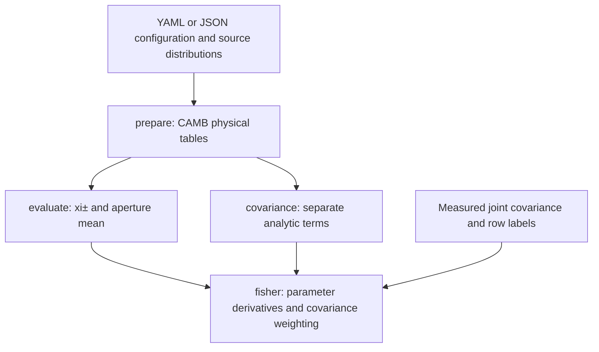

# DES two-point and three-point calculations

1. [Purpose and current scope](#scope)
2. [Build the compiled library](#build)
3. [Prepare and evaluate a data vector](#evaluate)
4. [Notebook examples](#notebooks)
5. [Covariances, Fisher calculations and tests](#tests)
6. [Survey inputs](#targets)
7. [Accuracy controls](ACCURACY.md)
8. [OpenMP scaling at ten random parameter points](BENCHMARK.md)
9. [Comparing with the original codes](COMPARISON.md)
10. [Joint forecasts without compressing the two-point vector](FISHER.md)
11. [Joint xi and aperture covariance](covariance/README.md)
12. [Configuration files](configs/README.md)
13. [Joint xi± and Map3 inference with Nautilus](INFERENCE.md)
14. [Paper targets and joint DES forecasts](PAPER_TARGETS.md)
15. [Paired baryonic responses](FEEDBACK.md)
16. [Optional compression and finite-simulation likelihoods](COMPRESSION.md)
17. [Matching the aperture estimator](ESTIMATOR.md)
18. [BACCO feedback in a joint shear forecast](BACCO.md)
19. [Supplying BiHalofit from Python](BIHALOFIT_PYTHON.md)
20. [Acknowledgements](#acknowledgements)

## Purpose and current scope <a name="scope"></a>

This project builds and tests the three-point code in
`cosmolike_core/cosmolike/3pcf/`. It follows the LSST Y1 project layout:
the core owns numerical C routines and the production/notebook C++
adapters, while this project owns the compiled-module registration and
tests. The project does not treat any existing LSST Y1 file as an
editable dependency.

The compiled calculation predicts BiHalofit matter bispectra, TATT and
velocity-shear intrinsic-shape terms, angular shear correlations, and
third-order aperture moments. It also constructs the analytic joint
covariance that a configuration requests. Python prepares physical
tables, reads survey files and forms Fisher derivatives. The optional
[supplied-bispectrum route](BIHALOFIT_PYTHON.md) prepares BiHalofit in Python
and passes its table to the C projection; the internal C fit remains the
default. The joint vector keeps every two-point row by default;
[optional fixed compression](COMPRESSION.md) applies the same matrix to
data, predictions and both covariance axes.
The
[core module guide](../../external_modules/code/cosmolike_core/cosmolike/3pcf/README.md)
explains the equations and estimator limits; the
[numerical guide](../../external_modules/code/cosmolike_core/cosmolike/3pcf/NUMERICS.md)
explains coarse calculations, dense linear reads, fixed quadrature and
shared work. The port leaves the existing two-point source files
unchanged.



The graph describes an executable calculation. Publication reproduction
also requires the same estimator, cuts, priors and likelihood
assumptions. The example configurations are starting points for
refinement, not accepted Y3 or Y6 likelihood settings.

## Build the compiled library <a name="build"></a>

We assume an existing Cocoa installation, its usual environment, and a
Bash shell in `Cocoa/`. This local development project needs no download
and installs no Python package. Its Makefile uses the existing compilers,
SIMDe, GSL, FFTW, Armadillo, OpenBLAS and pybind11. It compiles only the
three-point files and the project registration file.

**Step :one:**: activate the Cocoa environment.

```bash
source start_cocoa.sh
```

**Step :two:**: build with one compilation worker.

```bash
make -C projects/des_3pcf/interface -f MakefileCosmolike -j1
```

The build writes the extension into `interface/`. It exposes `production`
and `notebook` adapters to the same C calculations. The first borrows
correctly typed contiguous arrays; the second copies through Armadillo
arrays for interactive inspection. Both return arrays owned by Python.

> [!NOTE]
> This project is a local development build. It is not registered as a
> downloadable Cocoa project with a remote URL or release pin. The main
> setup scripts and other projects' compile settings are unchanged.

## Prepare and evaluate a data vector <a name="evaluate"></a>

We assume the build above, Cocoa activated, and a shell in `Cocoa/`.
The example uses the public Y3 source distributions. Numerical outputs
go to the paths that the YAML file names. Every configuration path is
relative to that file, independently of the shell's directory.

**Step :one:**: retrieve or verify the pinned Y3 inputs.

```bash
python projects/des_3pcf/scripts/fetch_y3_reference.py
```

This reads the twelve files that `data/y3_reference_manifest.json` lists,
checks their lengths and Git blob hashes, and stores them in
`data/upstream_y3/`. It does not download the whole simulation archive or
execute upstream code.

**Step :two:**: allow up to six OpenMP workers and select serial BLAS.

Linux:

```bash
export OMP_NUM_THREADS=6
export OMP_THREAD_LIMIT=6
export OMP_PROC_BIND=close
export OMP_PLACES=cores
export OMP_DYNAMIC=FALSE
export OPENBLAS_NUM_THREADS=1
export MKL_NUM_THREADS=1
export VECLIB_MAXIMUM_THREADS=1
export BLIS_NUM_THREADS=1
```

macOS:

```bash
export OMP_NUM_THREADS=6
export OMP_THREAD_LIMIT=6
export OMP_PROC_BIND=disabled
export OMP_PLACES=cores
export OMP_DYNAMIC=FALSE
export OPENBLAS_NUM_THREADS=1
export MKL_NUM_THREADS=1
export VECLIB_MAXIMUM_THREADS=1
export BLIS_NUM_THREADS=1
```

Set the YAML `threads` field to the intended worker count as well. The
driver applies that count after importing its compiled module.

**Step :three:**: create the processed demonstration source file.

```bash
python projects/des_3pcf/scripts/prepare_demo_sources.py \
  --input projects/des_3pcf/data/upstream_y3/data/dv/sim_2pt-NLA-cosmoCosmogrid-04Nov24.fits \
  --output projects/des_3pcf/runs/y3_demo_sources.fits \
  --extension nz_source --nbin 4
```

This clips the negative density samples in the public FITS table,
renormalizes each bin, and records the clipping in a separate JSON file.
It preserves the downloaded FITS file. The [Fisher guide](FISHER.md)
explains this demonstration-source assumption, and the
[accuracy guide](ACCURACY.md#source-curves) defines the reconstruction
and the sampling grids built from the processed file.

**Step :four:**: check the configuration before preparing physical tables.

```bash
python projects/des_3pcf/scripts/run_3pcf.py prepare \
  projects/des_3pcf/configs/des_y3_nla_demo_fisher.yaml --validate-config
```

`--validate-config`: report missing inputs without importing a compiled
extension, running CAMB or evaluating a physical integral. The check
does not establish numerical convergence.

**Step :five:**: prepare the physical tables.

```bash
python projects/des_3pcf/scripts/run_3pcf.py prepare \
  projects/des_3pcf/configs/des_y3_nla_demo_fisher.yaml
```

This calibrates the linear amplitude to the requested $`\sigma_8`$ and stores
power, growth and distance arrays.

**Step :six:**: evaluate the mean using the prepared tables.

```bash
python projects/des_3pcf/scripts/run_3pcf.py evaluate \
  projects/des_3pcf/configs/des_y3_nla_demo_fisher.yaml
```

This calculates every observable row that the configuration defines. The
driver refuses to replace an existing output file unless the command adds
`--overwrite`.

> [!TIP]
> For configuration choices and derivative checks, see the
> [Fisher guide](FISHER.md). For analytic covariance inputs, see the
> [covariance guide](covariance/README.md).

## Notebook examples <a name="notebooks"></a>

The notebooks explain the quantities before calling project wrappers and
the shared plotting functions. Model calculations use at most four OpenMP
workers and serial BLAS. Loading saved results never silently starts a new
survey calculation. Each physical comparison states its numerical and
estimator checks beside it.

| Notebook | What the examples examine |
|---|---|
| [EXAMPLE_COMPARE_CODES.ipynb](EXAMPLE_COMPARE_CODES.ipynb) | Comparisons with pinned original transforms and aperture kernels, with source discretization differences and stored physical references labeled separately |
| [EXAMPLE_IA_COMPONENTS.ipynb](EXAMPLE_IA_COMPONENTS.ipynb) | Projected IA operators and ordered GGI/GII/III placements through the finite aperture estimator, their sum against the ordinary total, and the recorded manuscript/code discrepancy in the signed VS curves |
| [EXAMPLE_COMPRESSION.ipynb](EXAMPLE_COMPRESSION.ipynb) | Optional xi-only, conditional and joint compression; local Fisher checks and finite-simulation assumptions |
| [EXAMPLE_FISHER_IA.ipynb](EXAMPLE_FISHER_IA.ipynb) | Y3 NLA and TATT means, parameter responses, saved joint Fisher comparisons and the checks needed before interpreting gains |
| [EXAMPLE_FISHER_ACCURACY.ipynb](EXAMPLE_FISHER_ACCURACY.ipynb) | Completed default h/h2 Fisher bases, screening of individually refined derivative columns, and full refined-grid checks where available; the notebook lists remaining cases as pending |
| [EXAMPLE_JOINT_FEEDBACK.ipynb](EXAMPLE_JOINT_FEEDBACK.ipynb) | Shared amplitude for power and bispectrum responses read from separate files |
| [EXAMPLE_FEEDBACK_SCENARIOS.ipynb](EXAMPLE_FEEDBACK_SCENARIOS.ipynb) | Seven physical Cocoa feedback scenarios in power and shear, plus paired BACCO cold-matter responses |
| [EXAMPLE_FISHER_BACCO.ipynb](EXAMPLE_FISHER_BACCO.ipynb) | Joint BACCO responses with explicit neutrino conversion, continuation and sampling comparisons; conditional feedback/IA Fisher forecast |
| [EXAMPLE_COVARIANCE_PME.ipynb](EXAMPLE_COVARIANCE_PME.ipynb) | Covariance correction using independent controlled Gaussian simulations, finite-sample product corrections and held-out validation |

We assume the compiled project and the thread environment above. Start in
`Cocoa/` and use the Cocoa Python kernel.

**Step :one:**: open the project notebooks.

```bash
jupyter lab projects/des_3pcf --no-browser
```

The [comparison guide](COMPARISON.md) explains original-source identities
and what agreement means. [PAPER_TARGETS.md](PAPER_TARGETS.md) distinguishes
the published claims from the proposed Fisher experiments. The
[shared plotting guide](../../external_modules/code/cosmolike_core/cosmolike_notebook_utils/3pcf/README.md)
teaches the triangle maps, aperture panels, signed components and covariance
figures. Its functions take arrays and do not choose a physical model.
The [Nautilus guide](INFERENCE.md) gives separate NLA and TATT synthetic
examples and an observed-data demonstration.
The [estimator and covariance record](tests/studies/estimator_conventions.md)
traces the published triangle bins, the representative-side rules and the
open provenance question for the joint covariance's Map3 sign.

## Covariances, Fisher calculations and tests <a name="tests"></a>

The [covariance guide](covariance/README.md) defines the full-filter
estimator, noise and center-window inputs, term outputs and physical
limitations. The [Fisher guide](FISHER.md) explains exact parameter keys,
derivative step checks, priors and the precision-matrix expansion.

The [test guide](tests/README.md) gives the commands for data-vector and
covariance calculations, strict/debug builds and thread comparisons. The
[validation record](tests/VALIDATION.md) identifies the executed checks.
These small checks exercise formulas, array layout and ownership without
running a survey-size calculation or measuring speed.

The C implementation lives in
`external_modules/code/cosmolike_core/cosmolike/3pcf/`. Its
[module guide](../../external_modules/code/cosmolike_core/cosmolike/3pcf/README.md)
and
[numerical guide](../../external_modules/code/cosmolike_core/cosmolike/3pcf/NUMERICS.md)
are the entry points for continuing the port in another checkout.

## Survey inputs <a name="targets"></a>

The intended survey applications are separate DES Y3 and DES Y6 Fisher
forecasts, keeping the full two-point vector as the primary joint option.
Reproduction targets are
[the joint two-/three-point analysis](https://arxiv.org/abs/2503.03964)
and [the TATT/velocity-shear analysis](https://arxiv.org/abs/2601.09133).
The Y3 repository contains source distributions, simulated and observed
unblinded aperture vectors, and joint covariance products. The reference
files contain 200 $`\xi_+`$, 200 $`\xi_-`$ and 80 aperture rows; the
matching covariance has dimension 480. The downloader records which
specific files it selects. The finite-SAS example reads those rows and
preserves their ordering. It does not infer that its finite triangle
settings or likelihood are the final publication settings merely from the
filenames. The observed files have a separate
[pinned manifest](data/y3_observed_manifest.json) and
[download procedure](INFERENCE.md#observed). Synthetic data remain useful
for testing a model without confusing estimator differences with an
observed residual.

The Y6 repository keeps its measurement files external. Its example
therefore leaves the source path unset and makes the proposed forecast
radii explicit. The analytic examples also leave catalogue area and
per-bin number density/shape dispersion unset. Gaussian nuisance priors
are empty. These are missing survey inputs, rather than numerical values
to infer from another release.

| Configuration | Observable and covariance choice |
|---|---|
| `configs/y3_full_filter_example.json` | Unrestricted aperture filters, every xi bin and the analytic covariance model |
| `configs/y3_finite_sas_example.json` | Pinned Y3 measured-row definitions, finite-triangle aperture calculation and the external joint covariance with its row labels |
| `configs/y6_full_filter_example.json` | Y6 forecast geometry with explicitly missing external source/catalogue inputs |

## Acknowledgements <a name="acknowledgements"></a>

**We thank Sunao Sugiyama and Rafael C. H. Gomes for their scientific work
and for making their three-point methods, implementations and analysis
pipelines available to the community. Their work is the foundation of this
CosmoLike port.**

**Special thanks to:**

- **Sunao Sugiyama**, for [fastnc](https://github.com/git-sunao/fastnc), its
  multipole method for shear three-point correlations, and the numerical
  organization on which our angular transforms build. We retain explicit
  references to both the [TATT branch](https://github.com/git-sunao/fastnc/tree/tatt)
  and the main branch when comparing their numerical conventions.
- **Rafael C. H. Gomes**, for the intrinsic-alignment modeling and DES
  two-/three-point analysis, and for
  [3pcf_integrator](https://github.com/rchgomes/3pcf_integrator) and
  [desy6-3pcf](https://github.com/rchgomes/desy6-3pcf). These repositories
  supply the aperture-integration and survey-workflow references used here.
- **Mike Jarvis**, for [TreeCorr](https://github.com/rmjarvis/TreeCorr) and
  its aperture kernels and shear-projection conventions, and **Xiao Fang**
  for the two-dimensional FFTLog method credited by the original transform
  implementation.

**Users of this port must give appropriate credit to the original software
and scientific papers.** Please cite the relevant papers below alongside
Cocoa/CosmoLike and the other methods used in the calculation.

| Original scientific work | Contribution used here |
|---|---|
| Sunao Sugiyama, Rafael C. H. Gomes and Mike Jarvis, [Fast modeling of the shear three-point correlation function](https://arxiv.org/abs/2407.01798) | Bispectrum multipoles, natural shear components and the fastnc method |
| Rafael C. H. Gomes and collaborators, [Cosmology with second and third-order shear statistics for the Dark Energy Survey: Methods and simulated analysis](https://arxiv.org/abs/2503.03964) | Joint two-/three-point analysis, aperture statistics and DES Y3 reference inputs |
| Rafael C. H. Gomes, Kyle Miller, Sunao Sugiyama, Jonathan Blazek, Thomas Bakx and Bhuvnesh Jain, [Tidal alignment and tidal torquing modeling for the cosmic shear three-point correlation function and mass aperture skewness](https://arxiv.org/abs/2601.09133) | Three-point TATT and velocity-shear intrinsic-alignment modeling |

The aperture formulas are due to
[Jarvis, Bernstein and Jain](https://arxiv.org/abs/astro-ph/0307393) and
[Schneider, Kilbinger and Lombardi](https://arxiv.org/abs/astro-ph/0308328).
The analytic covariance follows work by
[Linke and collaborators](https://arxiv.org/abs/2212.04485) and
[Wielders and collaborators](https://arxiv.org/abs/2509.20443).
The matter-bispectrum model is
[BiHalofit by Takahashi and collaborators](https://arxiv.org/abs/1911.07886),
and the precision-matrix expansion follows
[Friedrich and Eifler](https://arxiv.org/abs/1703.07786).

We also thank **Tim Eifler, Elisabeth Krause and the CosmoLike contributors**
for the numerical framework, and the Cocoa contributors for the project,
interface and notebook conventions. The core's `cosmolike/3pcf/CREDITS.md`
records inspected source revisions and the attribution and license details.
The implementation keeps the original notices.
