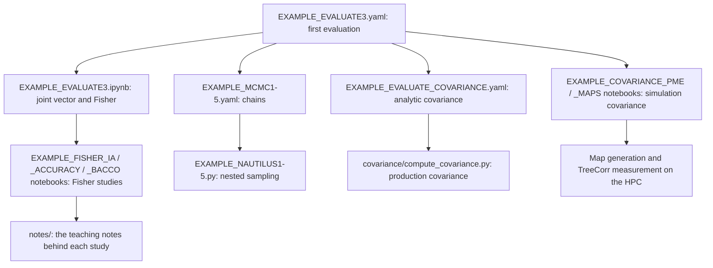

# Table of contents <a name="table_of_contents"></a>

1. [The DES Y3 joint two- and three-point data vector](#purpose)
2. [The five examples](#examples)
3. [Reading path through the examples](#reading_path)
4. [Running Cosmolike projects (Basic instructions)](#running_cosmolike_projects)
5. [Running Nautilus](#sampling)
6. [Running on an HPC cluster](#hpc)
7. [Baryonic feedback](#feedback)
8. [Running Fisher](#fisher)
9. [Unit tests](#unit_tests)
10. [Computing covariances](#computing_covariances)
11. [Generating and measuring the covariance maps](#covariance_maps)
12. [Exploring notebooks](#notebooks)
13. [Acknowledgements](#acknowledgements)
14. [Appendix](#appendix)

# The DES Y3 joint two- and three-point data vector <a name="purpose"></a>

This project calculates a joint cosmic-shear vector: two-point correlations
$`\xi_\pm`$ and third-order aperture moments $`\langle M_{\rm ap}^3\rangle`$.
The aperture moments measure the skewness of shear through a compensated
angular filter, so they respond to parameter combinations that look similar
in two-point data alone. The joint covariance determines how much
independent information the third-order rows add.

The inputs are the released DES Y3 products bundled under `data/`
([input guide](data/README.md)). The examples demonstrate calculations;
matching a published posterior also requires matching its estimator,
selection, priors and covariance treatment
([paper comparison](#estimator)). The method follows the
[fast-modeling paper](https://arxiv.org/abs/2407.01798) and the
[Y3 methods paper](https://arxiv.org/abs/2503.03964).

# The five examples <a name="examples"></a>

Each case number selects one analysis. `EXAMPLE_EVALUATE<n>.yaml`,
`EXAMPLE_MCMC<n>.yaml`, `EXAMPLE_NAUTILUS<n>.yaml` and
`EXAMPLE_NAUTILUS<n>.py` share the data, covariance, theory and priors of
case `n`; only the sampler changes. A `_sim` suffix on a dataset name
marks inputs built on simulated or synthetic vectors. All five cases read
the supplied simulation-estimated joint covariance, including its
two-/three-point cross terms.

| Case | Data | IA model | Likelihood | Rows kept | Dataset and example files |
|---|---|---|---|---|---|
| 1 | Observed (unblinded) Y3 measurements | NLA | [Percival](#percival), 796 simulations, `parameter_count = 15` | 227 of 400 $`\xi`$ rows (Y3 cosmic-shear scale cuts) and all 80 Map3 rows | `des_y3_joint1.dataset`; `EXAMPLE_EVALUATE1.yaml`, `EXAMPLE_MCMC1.yaml`, `EXAMPLE_NAUTILUS1.yaml`/`.py` |
| 2 | Observed (unblinded) Y3 measurements | NLA | Fixed Gaussian | All 480 rows | `des_y3_joint2.dataset`; `EXAMPLE_EVALUATE2.yaml`, `EXAMPLE_MCMC2.yaml`, `EXAMPLE_NAUTILUS2.yaml`/`.py` |
| 3 | Synthetic NLA fiducial mean | NLA | Fixed Gaussian | All 480 rows | `des_y3_joint3_sim.dataset`; `EXAMPLE_EVALUATE3.yaml`, `EXAMPLE_MCMC3.yaml`, `EXAMPLE_NAUTILUS3.yaml`/`.py` |
| 4 | Synthetic TATT fiducial mean | TATT | Fixed Gaussian | All 480 rows | `des_y3_joint4_sim.dataset`; `EXAMPLE_EVALUATE4.yaml`, `EXAMPLE_MCMC4.yaml`, `EXAMPLE_NAUTILUS4.yaml`/`.py` |
| 5 | Synthetic TATT fiducial mean | TATT | [Percival](#percival) with an independent-pilot MOPED compression | All 480 rows enter the compression | `des_y3_joint5_sim.dataset`; `EXAMPLE_EVALUATE5.yaml`, `EXAMPLE_MCMC5.yaml`, `EXAMPLE_NAUTILUS5.yaml`/`.py` |

Cases 1 and 2 score the observed DES Y3 data. Case 1 reruns the
published analysis where the project allows it
([published rerun](#published_rerun)); case 2 keeps every row with the
fixed Gaussian. Case 3 is the first example to run: its synthetic data
were generated at the example's own fiducial point, so one evaluation
checks the installation, and [EXAMPLE_EVALUATE3.ipynb](EXAMPLE_EVALUATE3.ipynb)
is its notebook. Case 4 repeats it with TATT, and case 5 demonstrates the
Percival likelihood under compression and first needs
`chains/independent_pilot_compression.npz` from
[EXAMPLE_COMPRESSION.ipynb](EXAMPLE_COMPRESSION.ipynb)
([compression FAQ](#compression)). For power-only feedback on the
two-point rows, `des_y3_xi3_sim.dataset` keeps only the 400 $`\xi`$ rows
([baryonic feedback](#feedback)).

## What "fixed Gaussian" and "Percival" mean <a name="percival"></a>

The covariance of every case is estimated from $`N_s = 796`$ simulations,
so it is not known exactly. A **fixed Gaussian** (cases 2-4) ignores that:
it uses $`\ln L = -\chi^2/2`$ with the covariance treated as exact. That is
fine for demonstrations, but its error bars come out too small, because
the inverse of a noisy covariance is biased high (the Hartlap correction)
and the noise also scatters the inferred parameters (the Dodelson-Schneider
effect).

**Percival** (cases 1 and 5) is the likelihood of
[Percival et al. 2022](https://arxiv.org/abs/2108.10402), which the
published DES Y3 analysis used. It replaces the Gaussian by a
t-distribution that accounts for the finite number of simulations:

```math
\ln L = -\frac{m}{2}\,\ln\!\left(1+\frac{\chi^2}{N_s-1}\right),\qquad
m = n_p + 2 + \frac{N_s - 1 + B\,(n_d - n_p)}{1 + B\,(n_d - n_p)},\qquad
B = \frac{N_s - n_d - 2}{(N_s - n_d - 1)(N_s - n_d - 4)},
```

with $`n_d`$ the number of data points and $`n_p`$ the number of sampled
parameters. The exponent $`m`$ is chosen so that the credible intervals
have the right frequentist coverage; both corrections above are built in,
so no separate Hartlap factor is applied.

For case 1, $`N_s = 796`$, $`n_d = 307`$ (the rows kept by the scale cuts)
and $`n_p = 15`$ give $`m \approx 514`$. Near the best fit this acts like a
Gaussian with the covariance inflated by about $`(N_s-1)/m \approx 1.5`$;
far from it the tails are heavier. Because $`m`$ depends on $`n_p`$,
`parameter_count` must equal the number of sampled parameters: it
changes the shape of the likelihood, not only its normalization. After
`ci.init_joint_data`, `ci.get_joint_exponent()` prints $`m`$.

The published analysis also compresses the cut $`\xi`$ block to 16 MOPED
modes, so $`n_d = 96`$ and the inflation is much smaller. Case 1 does
this once that matrix is set as `compression_file`. The dataset keys are
`mock_count` ($`N_s`$, 0 for the fixed Gaussian) and `parameter_count`
($`n_p`$).

# Reading path through the examples <a name="reading_path"></a>

Start with one evaluation of `EXAMPLE_EVALUATE3.yaml`
([basic instructions](#running_cosmolike_projects)): it checks the
installation that every later example uses.



- The numbered evaluate, MCMC and Nautilus examples share the five cases
  ([the five examples](#examples)); only the sampler changes.
- The Fisher notebooks and their teaching notes live under `notes/`
  ([exploring notebooks](#notebooks)).
- The analytic covariance needs the optional covariance build
  ([computing covariances](#computing_covariances)); the simulation route
  is the [map campaign](#covariance_maps).

# Running Cosmolike projects (Basic instructions) <a name="running_cosmolike_projects"></a> <a name="build"></a> <a name="evaluate"></a>

From `Cocoa/Readme` instructions:

> [!Note]
> `setup_cocoa.sh` and `compile_cocoa.sh` install and compile the cosmolike
> projects selected in `set_installation_options.sh`. A commented
> `IGNORE_COSMOLIKE_*_CODE` key enables a project; this project and TreeCorr
> (used by the [map campaign](#covariance_maps)) ship enabled.
>
>     [Adapted from Cocoa/set_installation_options.sh shell script]
>     #export IGNORE_TREECORR_CODE=1
>     (...)
>     #export IGNORE_COSMOLIKE_DES_3PCF_CODE=1
>     (...)
>     export DES_3PCF_URL="https://github.com/SBU-COSMOLIKE/cocoa_des_3pcf.git"
>     export DES_3PCF_NAME="des_3pcf"
>     export DES_3PCF_GIT_BRANCH="main"

> [!NOTE]
> If users want to recompile only this project, there is no need to rerun
> the Cocoa general scripts. Instead, run the two commands:
>
>      source start_cocoa.sh
>
> and
>
>      source ./projects/des_3pcf/scripts/compile_des_3pcf.sh

The numbered examples are the five cases of
[the five examples](#examples): the evaluate, MCMC and Nautilus files of
the same number select the same data, covariance, theory and priors, and
only sampler settings and output prefixes differ. The likelihood's
`omp_threads` key in `likelihood/joint_shear.yaml` sets the OpenMP
workers of each likelihood evaluation (the examples ship 1).

To run the example

**Step :one:**: activate the Cocoa Conda environment, and the private Python environment

      conda activate cocoa

and

      source start_cocoa.sh

**Step :two:**: Select the number of OpenMP cores (the commands below set it to 8).

  - Linux

        export OMP_NUM_THREADS=8; export OMP_PROC_BIND=close; \
        export OMP_PLACES=cores; export OMP_DYNAMIC=FALSE; \
        export OPENBLAS_NUM_THREADS=1; export MKL_NUM_THREADS=1

  - macOS (arm)

        export OMP_NUM_THREADS=8; export OMP_PROC_BIND=disabled; \
        export OMP_PLACES=cores; export OMP_DYNAMIC=FALSE; \
        export OPENBLAS_NUM_THREADS=1; export MKL_NUM_THREADS=1

**Step :three:**: run `cobaya-run` on case 2 following the commands below.

> [!Warning]
> (Linux only) In some HPC nodes, `numa` can cause you problems. If that is
> the case, replace `numa` with `slot`.

- **One model evaluation**:

  - Linux

        "${CONDA_PREFIX}"/bin/mpirun -n 1 --oversubscribe --mca pml ob1 --mca btl vader,tcp,self \
          --bind-to core:overload-allowed --report-bindings \
          --rank-by slot --map-by numa:pe=${OMP_NUM_THREADS} \
          cobaya-run ./projects/des_3pcf/EXAMPLE_EVALUATE3.yaml -f

  - macOS (arm)

        mpirun -n 1 --oversubscribe \
          cobaya-run ./projects/des_3pcf/EXAMPLE_EVALUATE3.yaml -f

- **MCMC (Metropolis-Hastings Algorithm)**:

  - Linux

        "${CONDA_PREFIX}"/bin/mpirun -n 4 --oversubscribe --mca pml ob1 --mca btl vader,tcp,self \
          --bind-to core:overload-allowed --report-bindings \
          --rank-by slot --map-by numa:pe=${OMP_NUM_THREADS} \
          cobaya-run ./projects/des_3pcf/EXAMPLE_MCMC3.yaml -f

  - macOS (arm)

        mpirun -n 4 --oversubscribe \
          cobaya-run ./projects/des_3pcf/EXAMPLE_MCMC3.yaml -f

Replace the number 2 with 1, 3, 4 or 5 to select another case
([the five examples](#examples)). Each YAML
writes to its own `chains/` prefix. The theory blocks run CAMB and the
BiHalofit matter bispectrum through Cobaya ([theory FAQ](#theory)); no
separate theory-table preparation command exists.

# Running Nautilus <a name="sampling"></a>

The five launchers follow `lsst_y1/EXAMPLE_EMUL2_NAUTILUS1.py`: they import
`run` from the core's `cocoa_hybrid_sampling` and pass the project and
example number. This project sets `hybrid=False`, so every rank evaluates
the physical theory. One MPI rank coordinates the Nautilus pool; the
remaining ranks evaluate separate models.

**Step :one:**: repeat the thread setup of the
[basic instructions](#running_cosmolike_projects) (Steps one and two), then
check the fiducial without sampling.

```bash
python ./projects/des_3pcf/EXAMPLE_NAUTILUS3.py --check
```

**Step :two:**: sample with an explicit budget.

- Linux

      "${CONDA_PREFIX}"/bin/mpirun -n 90 --oversubscribe \
        --mca pml ob1 --mca btl vader,tcp,self \
        -x PATH -x LD_LIBRARY_PATH -x PYTHONPATH -x CONDA_PREFIX -x ROOTDIR \
        -x OMP_NUM_THREADS -x OMP_PROC_BIND -x OMP_PLACES -x OMP_DYNAMIC \
        -x OPENBLAS_NUM_THREADS -x MKL_NUM_THREADS --mca mpi_yield_when_idle 1 \
        --mca btl_tcp_if_exclude lo,docker0,virbr0,ib0,eno1,enp1s0f0np0 \
        --bind-to core:overload-allowed --report-bindings \
        --rank-by slot --map-by numa:pe=${OMP_NUM_THREADS} \
        python ./projects/des_3pcf/EXAMPLE_NAUTILUS3.py --nlive 1000 --neff 10000 --maxfeval 100000

- macOS (arm)

      mpirun -n 12 --oversubscribe \
        python ./projects/des_3pcf/EXAMPLE_NAUTILUS3.py --nlive 1000 --neff 10000 --maxfeval 100000

The rank counts are example allocations, matching the main README's
Nautilus examples; size them to the machine. Launcher options, one per
flag:

- `--input`: select another Cobaya YAML.
- `--outroot`: change the chain basename.
- `--root`: select the directory containing `chains/`.
- `--nlive`, `--neff`, `--maxfeval`: live points, effective samples and
  the evaluation budget.

Outputs are GetDist `.1.txt` rows and `.paramnames`, an HDF5 checkpoint,
and a YAML record with the evidence and convergence status. Existing
records and chains are refused, as in the LSST driver; a run that reaches
its budget can have `converged: false`.

# Running on an HPC cluster <a name="hpc"></a>

Three words name the moving parts. A **node** is one physical computer of
the cluster. An **MPI rank** is one running copy of the program; ranks
exchange messages and can sit on different nodes. Cobaya MCMC runs one
chain per rank, and the Nautilus pool reserves one rank as coordinator.
An **OpenMP thread** is a worker inside one rank, sharing that rank's
memory: `OMP_NUM_THREADS` sets how many cores each rank uses for one
likelihood evaluation.

> [!NOTE]
> **Running on more than one node.**
>
> 1. **Network interface.** TCP must use an interface routable between compute
>    nodes. The tested UofA exclusion list is
>    `--mca btl_tcp_if_exclude lo,docker0,virbr0,ib0,eno1,enp1s0f0np0`; adapt it to the cluster.
>    On the tested UofA nodes this leaves `enp1s0f1np1` available.
>    Before launching, run `unset OMPI_MCA_btl_tcp_if_include` so an
>    inherited inclusion list cannot conflict with the explicit exclusion.
>    Keep `ib0` if routable IP-over-InfiniBand is the intended network. These
>    examples exchange parameter vectors and scalar scores, so communication
>    volume is small; actual scaling still depends on the machine.
> 2. **Environment.** Remote ranks need the same Cocoa paths and libraries:
>    `ROOTDIR`, `PATH`, `LD_LIBRARY_PATH`, `PYTHONPATH`, `CONDA_PREFIX`, OpenMP
>    and BLAS settings, and `CLIK_PATH`/`CLIK_DATA`/`CLIK_PLUGIN` when used.
>    Slurm normally exports the submitting environment (`--export=ALL`).
>    Explicit `-x` options also forward these variables with SSH launchers.
>    Activate Cocoa before launching; build/download flags do not replace
>    runtime paths. All nodes must see the same files at the same paths.
> 3. **Slurm geometry.** Keep `ntasks-per-node × cpus-per-task` within the
>    allocated physical cores per node. Set `OMP_NUM_THREADS` to
>    `SLURM_CPUS_PER_TASK` and use `--map-by numa:pe=${OMP_NUM_THREADS}`.
>    The minimization, profile and Nautilus pool reserves one MPI rank as
>    coordinator; the remaining ranks evaluate the model.

The submission file below holds the Slurm directives, the Cocoa
activation and the launch in one place, following the project's
`scripts/EXAMPLE_GPTG_*_UOFA.sbatch` files. Its `mpirun` line repeats the
Linux flags of the [basic instructions](#running_cosmolike_projects) plus
the multi-node forwarding options of the note above. The `--account`,
`--partition`, `--time` and node directives are site policy and are
always edited.

**Step :one:**: save the batch script below (the case-1 MCMC: four
chains, one rank each, eight OpenMP threads per rank on one node) and
submit it with `sbatch` from the activated Cocoa directory. Replace `-f`
(start fresh) with `-r` to resume a chain stopped by the wall-time limit.

```bash
#!/bin/bash
#SBATCH --job-name=D3PCF_MCMC1
#SBATCH --output=D3PCF_MCMC1-%j.out
#SBATCH --nodes=1
#SBATCH --ntasks-per-node=4
#SBATCH --cpus-per-task=8
#SBATCH --time=48:00:00
#SBATCH --partition=standard
#SBATCH --account=change_me
#SBATCH --export=ALL

cd "${SLURM_SUBMIT_DIR:?Submit from the Cocoa directory}" || exit 1
# Prefer activating Cocoa before sbatch so this job inherits its environment.
if [ -z "${ROOTDIR:-}" ]; then
    source "$(conda info --base)/etc/profile.d/conda.sh" || exit 1
    conda activate cocoa || exit 1
    source start_cocoa.sh || exit 1
fi

export OMP_NUM_THREADS="${SLURM_CPUS_PER_TASK}"; export OMP_PROC_BIND=close; \
export OMP_PLACES=cores; export OMP_DYNAMIC=FALSE; \
export OPENBLAS_NUM_THREADS=1; export MKL_NUM_THREADS=1

"${CONDA_PREFIX}"/bin/mpirun -n "${SLURM_NTASKS}" --oversubscribe \
  --mca pml ob1 --mca btl vader,tcp,self \
  -x PATH -x LD_LIBRARY_PATH -x PYTHONPATH -x CONDA_PREFIX -x ROOTDIR \
  -x OMP_NUM_THREADS -x OMP_PROC_BIND -x OMP_PLACES -x OMP_DYNAMIC \
  -x OPENBLAS_NUM_THREADS -x MKL_NUM_THREADS --mca mpi_yield_when_idle 1 \
  --mca btl_tcp_if_exclude lo,docker0,virbr0,ib0,eno1,enp1s0f0np0 \
  --bind-to core:overload-allowed --report-bindings \
  --rank-by slot --map-by numa:pe=${OMP_NUM_THREADS} \
  cobaya-run ./projects/des_3pcf/EXAMPLE_MCMC1.yaml -f
```

**Step :two:**: for the case-1 Nautilus run, keep the same file and
change the geometry and the launch line. One rank coordinates the pool
and every other rank evaluates a separate model, so more ranks shorten
the run; size the geometry to the machine.

```bash
#SBATCH --job-name=D3PCF_NAUTILUS1
#SBATCH --output=D3PCF_NAUTILUS1-%j.out
#SBATCH --nodes=2
#SBATCH --ntasks-per-node=24
#SBATCH --cpus-per-task=4
```

and, in place of the `cobaya-run` line,

```bash
  python ./projects/des_3pcf/EXAMPLE_NAUTILUS1.py --nlive 1000 --neff 10000 --maxfeval 100000
```

## Rerunning the published DES Y3 analysis <a name="published_rerun"></a>

Case 1 scores the observed (unblinded) DES Y3 data with the published
setup where the project allows it: the Y3 cosmic-shear $`\xi_\pm`$ scale
cuts (227 of 400 $`\xi`$ rows, all 80 Map3 rows) and the Percival
likelihood with `mock_count = 796` and `parameter_count = 15`, the 15
parameters case 1 samples (the published analysis used 16, as it also
samples $`m_\nu`$)
(`data/des_y3_joint1.dataset`).

**Step :one:**: evaluate the fiducial once, with the thread setup of the
[basic instructions](#running_cosmolike_projects):

    "${CONDA_PREFIX}"/bin/mpirun -n 1 --oversubscribe --mca pml ob1 --mca btl vader,tcp,self \
      --bind-to core:overload-allowed --report-bindings \
      --rank-by slot --map-by numa:pe=${OMP_NUM_THREADS} \
      cobaya-run ./projects/des_3pcf/EXAMPLE_EVALUATE1.yaml -f

**Step :two:**: sample on the cluster with the case-1 MCMC or Nautilus
batch script above.

The remaining differences from the published analysis:

- **Compression.** `compression_file` in `des_y3_joint1.dataset` stays
  empty until the published 16-mode MOPED matrix is confirmed; the
  published analysis compresses the cut $`\xi`$ block to 16 modes.
- **Priors (by design).** $`10^9 A_\mathrm{s}`$ is sampled with
  lsst_y1's prior and $`\sigma_8`$ is derived, against the published
  uniform $`S_8`$ prior; $`m_\nu`$ is fixed at 0.06 eV, against the
  published sampled $`m_\nu`$.
- **Bispectrum.** Exact BiHalofit, against the published neural-network
  emulator.
- **Sampler.** Cobaya MCMC and Nautilus, against the published
  MultiNest.

For the simulated-analysis check, copy `data/des_y3_joint1.dataset` and
set `data_file = des_y3_sim.datavector` in the copy: the released
simulated measurement at the CosmoGrid cosmology then replaces the
observed data under the same cuts and likelihood.

# Baryonic feedback <a name="feedback"></a>

Two optional feedback routes exist. Both keep BiHalofit enabled: it
supplies the absolute gravity-only bispectrum $`B_{\rm DMO}`$, and CAMB
supplies the common cosmology. The physics is derived in the
[feedback note](notes/baryonic_feedback/baryonic_feedback.pdf). The
published DES Y3 analysis handled baryons with scale cuts, while the DES
Y6 prescription applies BACCO responses, implemented in the `tatt` branch
of [fastnc](https://github.com/git-sunao/fastnc), which this project
cites and never runs.

**Paired BACCO responses on the joint vector.** BACCO supplies the paired
ratios $`R_P=P_{\rm hydro}/P_{\rm DMO}`$ and
$`R_B=B_{\rm hydro}/B_{\rm DMO}`$ from compatible simulations; a power
response alone does not determine the bispectrum response.

**Step :one:**: in [EXAMPLE_EVALUATE3.yaml](EXAMPLE_EVALUATE3.yaml),
uncomment the `bacco_bispectrum` theory block.

**Step :two:**: uncomment `external_baryon_response: true` in the
likelihood block and the five commented `*_baccoemu` parameters.

> [!Warning]
> The supplied fiducial point is inside the emulator's trained domain;
> before sampling, restrict the cosmological and feedback priors to that
> domain. The BACCO theory guide,
> `cosmolike_core/theory/bacco_bispectrum/README.md`, states the parameter
> bounds, the neutrino conversion and the continuation settings.

**Power-only suppression on the two-point rows.** The power-only feedback
models of the `bfmt` theory block supply no bispectrum response, so they
apply only to a xi-only selection: set `data_file: des_y3_xi3_sim.dataset` and
`external_baryon_suppression: true` in the likelihood block, and add the
`bfmt` theory block with its model choice and parameters
(`external_modules/code/baryon_suppression/README.md` lists them). The
likelihood refuses this key while Map3 rows are kept, and refuses it
together with `external_baryon_response`.

[EXAMPLE_JOINT_FEEDBACK.ipynb](EXAMPLE_JOINT_FEEDBACK.ipynb) scans the
BACCO response on the joint mean, and
[EXAMPLE_FEEDBACK_SCENARIOS.ipynb](EXAMPLE_FEEDBACK_SCENARIOS.ipynb)
compares the installed power-only scenarios of
[configs/feedback_scenarios.yaml](configs/feedback_scenarios.yaml).

# Running Fisher <a name="fisher"></a>

[EXAMPLE_EVALUATE3.ipynb](EXAMPLE_EVALUATE3.ipynb) shows the ordinary
workflow: evaluate the numbered Cobaya model, differentiate its data
vector, and call the shared Fisher functions of
`cosmolike_core/cosmolike_notebook_utils/` (section "Fisher"). Derivatives
and matrices are saved under `chains/`. The IA, accuracy and BACCO
notebooks ([exploring notebooks](#notebooks)) follow the same calling
pattern on their own questions; their unmasked, uncompressed rows match
numbered cases 3 and 4.

# Unit tests <a name="unit_tests"></a> <a name="tests"></a>

The `tests/` folder checks the physical data-vector components, the
covariance terms, the likelihood and the drivers against stored references
and analytic formulas. [tests/README.md](tests/README.md) describes the
checks and how to run them; [optional studies](tests/studies/README.md)
hold the expensive refinement measurements and their saved records.

# Computing covariances <a name="computing_covariances"></a> <a name="covariance"></a>

The compiled calculation returns the joint analytic covariance of the
$`\xi_\pm`$ rows at the fiducial point of
[EXAMPLE_EVALUATE_COVARIANCE.yaml](EXAMPLE_EVALUATE_COVARIANCE.yaml).
[covariance/README.md](covariance/README.md) explains the optional
covariance build, the driver `covariance/compute_covariance.py`, the
physical terms and the limits; the Map3 rows are refused until a
covariance matching the finite-SAS estimator exists, which is why the
examples read the supplied simulation-estimated covariance instead. The
simulation route, which estimates the full joint matrix from synthetic
maps, is the [map campaign below](#covariance_maps).

# Generating and measuring the covariance maps <a name="covariance_maps"></a>

The simulation covariance route generates an ensemble of synthetic
DES-footprint shear maps with the point-transformed Gaussian method of
[Zhong et al.](https://arxiv.org/abs/2411.04759), then measures each map's
480-entry joint vector (400 $`\xi_\pm`$ entries and 80 third-order
aperture entries) with TreeCorr. The covariance analysis consumes only
complete vectors. The method, its calibration and its validation limits
are derived in the [map note](notes/gptg_simulations/gptg_simulations.pdf)
with its [companion notebook](notes/gptg_simulations/EXAMPLE_GPTG_SIMULATIONS.ipynb);
the [map download guide](notes/covariance_from_simulations/MAPS_README.md)
describes the downloaded CosmoGrid DES Y3 maps the calibration was
fitted to.

This section explains the compute pattern once, then runs each job as a
worked example on the University of Arizona cluster. The two `sbatch`
files generalize to any Slurm machine: only their site-specific directives
and network-interface line change. Besides TreeCorr (installed through its
Cocoa key above), both jobs need `ducc0`, `astropy-healpix` and `mpi4py`
built on the cluster, with `mpi4py` using the cluster's MPI installation.

## The compute pattern <a name="compute_pattern"></a>

Both jobs run one MPI program with the same layout: rank zero coordinates
and is the only writer, and every other rank owns one whole map at a time.
A finished task is checkpointed by writing a temporary file and atomically
replacing the map's output, so a task interrupted before its save reruns
and saved work survives any interruption. Generation and measurement are
separate submissions; neither starts the other.

Each generation worker runs its spherical transforms with the few native
threads set by the script's `--threads` option. Each TreeCorr measurement
worker uses one CPU, even though TreeCorr is built with OpenMP. BLAS stays
at one thread in every rank.

| Slurm directive | What it controls | How to choose it |
|---|---|---|
| `--account` | The allocation charged | Site policy; always edited |
| `--partition` | The queue | Site policy; always edited |
| `--time` | The wall-time limit | Site policy; resume by resubmitting |
| `--nodes` | Node count | With the two rows below, tasks per node times CPUs per task must fit the allocated physical cores |
| `--ntasks-per-node` | MPI ranks per node | The total rank count includes the coordinator |
| `--cpus-per-task` | CPUs per rank | Four for generation (`--threads`), one for measurement |
| `--export=ALL` | The job's environment | The job inherits the activated Cocoa paths and the `GPTG_*` keys |

The measurement script also accepts Slurm array indices. With its range
size setting $`R`$, array task $`k`$ owns map IDs $`[kR,(k+1)R)`$: at the
default size, task 0 handles IDs 0-4999, task 1 handles 5000-9999 and
task 2 handles 10000-14999. Each task writes under its own
`full_joint_480_shards/<start>_<stop>/` directory, so concurrent array
tasks never share a checkpoint directory. Keep the range size fixed across
resubmissions so a task finds its checkpoints.

On resume, the script reads each map's saved 480-entry vector:

- **All entries finite:** skip the entire map.
- **Some tasks saved:** compute only tasks with missing or `NaN` entries.
- **No saved vector:** compute all tasks for that map.

> [!Warning]
> Never run two jobs against the same checkpoint directory at the same
> time; there is no inter-job lock. Different array indices are safe
> exactly because their directories differ. Do not run one array index
> twice at once.

## Running map generation (worked example: University of Arizona)

[EXAMPLE_GPTG_GENERATE_UOFA.sbatch](scripts/EXAMPLE_GPTG_GENERATE_UOFA.sbatch)
holds the Slurm directives, the Cocoa activation and the `mpirun` command
for `scripts/generate_ensemble_mpi.py` in one standalone file. Its
site-specific lines are the account, partition, node/task/time directives
and the TCP interface exclusion list; the `mpirun` command, the
environment forwarding and the `GPTG_*` keys transfer unchanged to
another cluster. The maps use total $`\Omega_{\rm m}=0.26`$ with
$`m_\nu=0.06`$ eV; the fixed analytical two-point block of the later
analysis uses that same total $`\Omega_{\rm m}`$ with $`m_\nu=0`$
([covariance note](notes/covariance_from_simulations/covariance_from_simulations.pdf)).

**Step :one:**: prepare the calibration package with the "Prepare the
physical-power model" section of the
[companion notebook](notes/gptg_simulations/EXAMPLE_GPTG_SIMULATIONS.ipynb).
These are the only generation inputs to transfer:

| File | Meaning |
|---|---|
| `calibration.yaml` | Cosmology, resolution, noise and model assumptions |
| `calibration.npz` | Target convergence spectra, point parameters and pixel noise |
| `indices_2048.npy` | RING pixel addresses of the refined footprint |

**Step :two:**: copy the three files (for example with `rsync -avP`) from
the local `chains/gptg_physical_l4096/` to an absolute calibration
directory on the cluster's shared storage.

**Step :three:**: on the cluster, activate Cocoa from its top directory
and select the keys below; keep both paths unchanged on resubmission.
Export `GPTG_COMPARISON_COUNT` and `GPTG_VALIDATION_COUNT` to choose the
two group sizes (their seed ranges are separate; validation may be zero
for a pilot), or unset them to use the script's defaults.

```bash
source start_cocoa.sh
```

```bash
export GPTG_CALIBRATION_DIR="/absolute/path/to/gptg_calibration"
export GPTG_OUTPUT_DIR="${ROOTDIR}/projects/des_3pcf/chains/gptg_refined"
export GPTG_NSIDE=2048
export GPTG_LMAX=4096
```

**Step :four:**: check one worker before filling the allocation; the
command-line Slurm options override the file's header and write to a
separate pilot directory. Check the completed pilot's `MaxRSS` and
map-generation time with `sacct` before choosing how many ranks share a
node.

```bash
sbatch --nodes=1 --ntasks=2 --ntasks-per-node=2 --ntasks-per-socket=1 --export="ALL,GPTG_OUTPUT_DIR=${GPTG_OUTPUT_DIR}_pilot,GPTG_COMPARISON_COUNT=1,GPTG_VALIDATION_COUNT=0" projects/des_3pcf/scripts/EXAMPLE_GPTG_GENERATE_UOFA.sbatch
```

**Step :five:**: submit the production allocation after the pilot
succeeds. Resubmit the same command with the same output and calibration
after a wall-time stop; completed map IDs are skipped.

```bash
sbatch projects/des_3pcf/scripts/EXAMPLE_GPTG_GENERATE_UOFA.sbatch
```

**Step :six:**: after completion, audit the expected IDs, seeds, map
headers and file lengths; the audit does not run TreeCorr or scan every
pixel.

```bash
python projects/des_3pcf/scripts/verify_ensemble.py "$GPTG_OUTPUT_DIR"
```

## Running the TreeCorr measurement (worked example: University of Arizona)

[EXAMPLE_GPTG_TREECORR_UOFA.sbatch](scripts/EXAMPLE_GPTG_TREECORR_UOFA.sbatch)
is the matching standalone submission file for
`scripts/measure_full_joint_mpi.py`. The measurement needs the project
checkout, with its bundled `data/upstream_y3/` inputs, on storage visible
at the same path on every node.

**Step :one:**: with the Conda environment of the
[basic instructions](#running_cosmolike_projects) active, initialize
Cocoa once before submission, so the batch job inherits its paths:

```bash
source start_cocoa.sh
```

**Step :two:**: point the job at the ensemble's absolute parent directory
and check its layout.

```bash
export GPTG_MAP_DIR="/absolute/path/to/gptg"
```

| File or folder under `$GPTG_MAP_DIR` | Requirement |
|---|---|
| `indices_512.npy` | Required at startup; the footprint pixel indices matching these maps |
| `comparison/` | Holds the comparison maps `GPTG_DES_*.npy`; create it before uploading |
| `validation/` | Holds the validation maps; create it even while its upload has not started |
| `calibration.yaml`, `calibration.npz`, `ensemble.yaml` | Generation provenance; kept beside the maps to interpret the ensemble |
| `full_joint_480/` | Output, created automatically; preserve it and its partial vectors when resuming |

> [!NOTE]
> To start measuring while uploads continue, export
> `GPTG_WAIT_FOR_READY=1` before `sbatch`. Each map then needs a companion
> `.npy.ready` marker created only after its transfer succeeded, because
> file existence alone cannot distinguish a complete map from an
> interrupted upload. Workers measure marked maps, poll for later
> arrivals, and consume allocated wall time while waiting.

**Step :three:**: submit the allocation; add `--array=<k>` to submit one
ID range instead.

```bash
sbatch projects/des_3pcf/scripts/EXAMPLE_GPTG_TREECORR_UOFA.sbatch
```

**Step :four:**: inspect the queue (`squeue -u "$USER"`) and the log,
`D3PCF_TC-<jobid>.out` in the submission directory. A map prints one line
when it finishes its $`\xi_\pm`$ block (`2pt done`) and one for its Map3
block (`3pt done`):

```text
map 60 2pt done compute seconds this run 1040.5 completed entries 400/480
map 60 3pt done compute seconds this run 24000.8 completed entries 480/480
```

`map` is the simulation ID, the seconds are the worker's summed task
times for the block in this allocation only, and `completed entries`
counts finite entries for that map, out of 480. A quiet log can mean workers are
computing inside a block; three-point entries cost far more than
two-point entries.

**Step :five:**: after a wall-time stop, wait until the old job has left
the queue (including `COMPLETING`), then resubmit the same script with the
same `GPTG_MAP_DIR`. No resume flag exists; the per-map rules of the
[compute pattern](#compute_pattern) decide what is recomputed.

**Step :six:**: after all measurement jobs have ended, combine the shard
checkpoints into `full_joint_480/`. The merge fills missing entries and
refuses conflicting finite values; run it only when every writer has
stopped.

```bash
python projects/des_3pcf/scripts/measure_full_joint_mpi.py --merge-shards --maps-dir "$GPTG_MAP_DIR"
```

Measurement IDs are immutable, so partial vectors stay valid when the
ensemble target grows; they are not a contiguous comparison/validation
split:

| Measurement ID | Input group | Local map ID |
|---|---|---|
| 0-9999 | comparison | 0-9999 |
| 10000-14999 | validation | 0-4999 |
| 15000-34999 | comparison | 10000-29999 |
| 35000-39999 | validation | 5000-9999 |

The runner records its estimator revision in the saved vectors and refuses
to resume or merge results measured with a different revision; use a fresh
measurement directory for a changed estimator or a replacement ensemble.
It selects NSIDE 512 geometry, so the refined NSIDE 2048 ensemble needs
its geometry and angular settings validated before measurement. The
analytical two-point block of the fixed-block analysis comes from the
DES Y3 project's covariance command:

```bash
python projects/des_y3/covariance/compute_covariance.py projects/des_y3/EXAMPLE_EVALUATE_COVARIANCE.yaml --output projects/des_3pcf/chains/gptg_ensemble_15000/des_y3_full_covariance.npz
```

> [!NOTE]
> The multi-node note of the [HPC section](#hpc) (network interface,
> environment, Slurm geometry) applies to these jobs as well.

Measured precision, timing and completeness evidence for the generator and
the measurement lives under `tests/gptg_pilot/`; the
[map note](notes/gptg_simulations/gptg_simulations.pdf) derives the
estimator, the shared-pixel Map3 recovery, the optional GPU transforms and
the fixed-block analysis.

# Exploring notebooks <a name="notebooks"></a>

We assume Cocoa and this project are installed, the Cocoa Conda
environment is active, the shell is Bash, and the current folder is
`cocoa/Cocoa/`.

> [!NOTE]
> The example notebooks load shared support functions from
> `cosmolike_core/cosmolike_notebook_utils/` through the `cnu` namespace.
> What is specific to this project lives in
> `interface/cosmolike_des_3pcf_notebook_wrappers.py`, imported as `nw`:
> the fiducial point and the $`\xi_\pm`$, Map3, data-vector, $`\chi^2`$
> and IA-component wrappers around the Cobaya likelihood.

**Step :one:**: activate Cocoa.

```bash
source start_cocoa.sh
```

**Step :two:**: Select the number of OpenMP cores (below, we set it to 8).

  - Linux

        export OMP_NUM_THREADS=8; export OMP_PROC_BIND=close; \
        export OMP_PLACES=cores; export OMP_DYNAMIC=FALSE; \
        export OPENBLAS_NUM_THREADS=1; export MKL_NUM_THREADS=1

  - macOS (arm)

        export OMP_NUM_THREADS=8; export OMP_PROC_BIND=disabled; \
        export OMP_PLACES=cores; export OMP_DYNAMIC=FALSE; \
        export OPENBLAS_NUM_THREADS=1; export MKL_NUM_THREADS=1

**Step :three:**: start Jupyter.

```bash
jupyter notebook --no-browser --port=8888
```

**Step :four:**: open the printed URL and choose a notebook below.

**Step :five:**: select **Kernel → Restart Kernel and Run All Cells**,
with the Python kernel of the activated Cocoa environment; restart the
kernel after recompiling.

| Notebook | Question addressed |
|---|---|
| [EXAMPLE_EVALUATE3.ipynb](EXAMPLE_EVALUATE3.ipynb) | What does one joint evaluation return, and how does its Fisher forecast follow? |
| [IA notebook](notes/intrinsic_alignments/EXAMPLE_FISHER_IA.ipynb) and [teaching note](notes/intrinsic_alignments/intrinsic_alignments.pdf) | How do NLA/TATT responses and joint Fisher constraints compare? |
| [Aperture-mass notebook](notes/aperture_mass_statistic/aperture_mass_statistic.ipynb) and [teaching note](notes/aperture_mass_statistic/aperture_mass_statistic.pdf) | What is the third-order aperture mass, and how are the 80 Map3 rows computed? |
| [EXAMPLE_FISHER_ACCURACY.ipynb](EXAMPLE_FISHER_ACCURACY.ipynb) | Which sampling controls and derivative steps stabilize the forecast? |
| [EXAMPLE_IA_COMPONENTS.ipynb](EXAMPLE_IA_COMPONENTS.ipynb) | How do ordered intrinsic-alignment terms enter the aperture signal? |
| [EXAMPLE_JOINT_FEEDBACK.ipynb](EXAMPLE_JOINT_FEEDBACK.ipynb) | How do separate power and bispectrum responses change the joint mean? |
| [EXAMPLE_FEEDBACK_SCENARIOS.ipynb](EXAMPLE_FEEDBACK_SCENARIOS.ipynb) | What changes among the installed Cocoa feedback scenarios? |
| [BACCO notebook](notes/baryonic_feedback/EXAMPLE_FISHER_BACCO.ipynb) and [teaching note](notes/baryonic_feedback/baryonic_feedback.pdf) | How do neutrino conversion and extrapolation affect BACCO forecasts? |
| [EXAMPLE_COMPRESSION.ipynb](EXAMPLE_COMPRESSION.ipynb) | What local information does each optional compression preserve? |
| [EXAMPLE_COVARIANCE_PME.ipynb](EXAMPLE_COVARIANCE_PME.ipynb) | How do we compute the noisy-square correction, one matrix operation at a time? |
| [EXAMPLE_COVARIANCE_MAPS.ipynb](EXAMPLE_COVARIANCE_MAPS.ipynb) | What can a bounded aperture-moment experiment establish with the downloaded maps? |
| [Comparison notebook](notes/covariance_comparison/EXAMPLE_COVARIANCE_COMPARISON.ipynb) and [note](notes/covariance_comparison/covariance_comparison.pdf) | How do the direct and precision-expansion covariances differ on the measured vectors? |
| [Map notebook](notes/gptg_simulations/EXAMPLE_GPTG_SIMULATIONS.ipynb) and [note](notes/gptg_simulations/gptg_simulations.pdf) | How are the synthetic maps generated, measured and analyzed? |
| [EXAMPLE_COMPARE_CODES.ipynb](EXAMPLE_COMPARE_CODES.ipynb) | Which calculations agree with the original libraries? |

A saved notebook output describes its recorded inputs; editing a path
does not recompute that result.

# Acknowledgements <a name="acknowledgements"></a>

**We thank Sunao Sugiyama and Rafael C. H. Gomes for their scientific work
and for making their methods and code available. Their work is the
foundation of this three-point port.**

- Sunao Sugiyama: [fastnc](https://github.com/git-sunao/fastnc), including
  its [TATT branch](https://github.com/git-sunao/fastnc/tree/tatt), and the
  shear three-point multipole method.
- Rafael C. H. Gomes: [3pcf_integrator](https://github.com/rchgomes/3pcf_integrator),
  [desy6-3pcf](https://github.com/rchgomes/desy6-3pcf), and the joint
  two-/three-point and intrinsic-alignment analyses.

Please cite their [fast-modeling paper](https://arxiv.org/abs/2407.01798),
[Y3 methods paper](https://arxiv.org/abs/2503.03964), and
[TATT/velocity-shear paper](https://arxiv.org/abs/2601.09133) when using
these methods, alongside Cocoa/CosmoLike and the selected theory model.

We also thank Mike Jarvis for TreeCorr, Xiao Fang for the FFTLog
method, and Tim Eifler, Elisabeth Krause and the CosmoLike contributors
for the numerical framework. Aperture formulas follow
[Jarvis, Bernstein and Jain](https://arxiv.org/abs/astro-ph/0307393) and
[Schneider, Kilbinger and Lombardi](https://arxiv.org/abs/astro-ph/0308328).
Covariance methods include [Linke et al.](https://arxiv.org/abs/2212.04485)
and [Wielders et al.](https://arxiv.org/abs/2509.20443); the precision
expansion follows [Friedrich and Eifler](https://arxiv.org/abs/1703.07786).
The core credit record, `cosmolike_core/cosmolike/3pcf/CREDITS.md`,
preserves source revisions and license notices.

# Appendix <a name="appendix"></a>

## FAQ: Where are the input and output files? <a name="files"></a>

| Location | Contents |
|---|---|
| `data/` | The released FITS products, the ASCII inputs the likelihood reads, the pixel window and their provenance |
| `chains/` | Generated predictions, derivatives, compression matrices, figures and sampler results; ignored by Git |
| `tests/` | Reference predictions and recorded numerical comparisons |
| `likelihood/` | The Cobaya likelihood `des_3pcf.joint_shear`, its survey readers and YAML defaults |
| `interface/` | The compiled extension, its loader and the notebook wrappers |
| `covariance/` | The analytic covariance driver and its guide |
| `scripts/` | The compile script and the map-generation and TreeCorr production programs |

The inputs are committed; `scripts/download_y3_data.sh` re-downloads the
DES Y3 files from their public source and checks their recorded hashes,
and `scripts/convert_desy3_fits.py` rebuilds the ASCII likelihood inputs
from the released FITS files. The [input guide](data/README.md)
identifies the included files, their formats, their provenance records
and the processed demonstration source.

## FAQ: How does the theory interface supply the bispectrum? <a name="theory"></a>

The example YAMLs select `camb` and `bihalofit` as separate Cobaya theory
blocks, and the likelihood reads their products through Cobaya. A
replacement bispectrum producer must supply the same `matter_bispectrum`
array contract; the likelihood never runs a private CAMB or BiHalofit
calculation. The fit equations, sampling and calibration limits belong to
the theory guide, `cosmolike_core/theory/bihalofit/README.md`.

## FAQ: Which accuracy settings are available? <a name="accuracy"></a>

[EXAMPLE_FISHER_ACCURACY.ipynb](EXAMPLE_FISHER_ACCURACY.ipynb) loads a
numbered evaluate YAML, states physical parameter steps and priors, and
varies ordinary likelihood settings for each refinement. The global and
individual boosts are defined in the core accuracy reference,
`cosmolike_core/cosmolike/3pcf/README.md` (section "Accuracy controls");
the noise estimate and step conventions are in the shared Fisher guide,
`cosmolike_core/cosmolike_notebook_utils/README.md`. DES-specific
measurements are in the
[study record](tests/studies/implementation_record.md#accuracy).

## FAQ: What does optional compression change? <a name="compression"></a>

Compression replaces the data and every predicted mean by $`Td`$ and
$`T\mu`$, and the covariance by $`TCT^{\mathsf T}`$. Train and then hold
$`T`$ fixed; changing it during inference changes the statistic.
[EXAMPLE_COMPRESSION.ipynb](EXAMPLE_COMPRESSION.ipynb) compares xi-only,
conditional-xi and full-joint choices and writes the matrices to `chains/`.

Case 5 reads `chains/independent_pilot_compression.npz`. Its Percival
likelihood assumes a sample covariance from independent Gaussian mocks,
independent data and an independently trained compression; it is not a
Hartlap-rescaled Gaussian and must not be combined with that correction.
The declared 796 mocks are an analysis assumption, not an established
count of independent skies.

## FAQ: How do the included Y3 products relate to the published analysis? <a name="estimator"></a>

The included Y3 products have 200 $`\xi_+`$, 200 $`\xi_-`$ and 80 Map3
rows. Matching those counts does not match the published estimator, and
exact published inference also needs the original compression, scale cuts,
priors and finite-simulation likelihood.

The Y3 Map3 was measured with TreeCorr 5.1.1's LogMultipole method on 20
logarithmic side bins from 0.5 to 80 arcmin and converted to
side-angle-side (SAS) form: a SAS bin names a triangle by one bin for
each of two side lengths plus one opening-angle bin, a slice of the
angle between those two sides on $`[0, \pi]`$. The scale cut kept the 9
side bins whose lower edge is at least 8 arcmin, and the likelihood
integrates its Map3 prediction over those same 9 bins
([likelihood/joint_shear.yaml](likelihood/joint_shear.yaml)).

The conventions below fix where inside each bin the prediction is
evaluated, so a different choice for any of them moves the predicted
rows (confirmed by the measurement's author, R. Gomes):

- The SAS conversion used TreeCorr's `toSAS()` with
  `phi_bin_size = 0.05`, which covers $`[0, \pi]`$ with 63 opening-angle
  bins. The likelihood uses `phi_bins: 63`, evaluated at the bin centres
  on $`[0, \pi]`$.
- Each side enters at its geometric bin centre, the lower edge times
  $`e^{\Delta/2}`$ for log bin width $`\Delta`$. This is the aperture
  plan's default side rule, and the likelihood does not override it.
- The aperture integral (fastnc, building on TreeCorr's calculation)
  sums over both orderings of the two sides, $`r_1 \le r_2`$ and
  $`r_1 \ge r_2`$; the likelihood's plan integrates over all ordered
  side pairs.
- The theory kept three-point multipoles up to $`n = 100`$: the
  correlation is expanded as a Fourier series in the opening angle, and
  the cutoff $`n`$ is the largest order kept. The likelihood default
  `map_mmax: 20` is converged against that cutoff:
  [tests/test_map_multipole_truncation.py](tests/test_map_multipole_truncation.py)
  evaluates the fiducial at 20
  and at 100 and bounds the relative Map3 change below $`10^{-8}`$ and
  the covariance-weighted distance $`d^{\mathsf T} C^{-1} d`$ of the
  change $`d`$ below $`10^{-12}`$. The separate Legendre cutoff of the
  bispectrum expansion matters more: raising `map_lmax` from 20 to the
  published 50 changes Map3 by up to 0.26 % with
  $`d^{\mathsf T} C^{-1} d \approx 10^{-3}`$, adequate for the mean (the
  same test bounds it); convergence of Fisher derivatives in `map_lmax`
  is not yet shown.
- The HEALPix pixel window entered only the simulations; the theory for
  the DES Y3 catalogue measurement has none, and the likelihood applies
  none. The pixel-window comparison is in
  [EXAMPLE_COMPARE_CODES.ipynb](EXAMPLE_COMPARE_CODES.ipynb).
- All released covariances used 796 simulations; the smaller `NSIM`
  header values in the released files are typos
  ([data/README.md](data/README.md)).

The measurement scripts are stored at NERSC.

The [estimator study](tests/studies/estimator_conventions.md) records the
measurement conventions and the remaining Map3 cross-covariance sign
question; the
[comparison record](tests/studies/implementation_record.md#paper_targets)
separates figure-level tests from inference claims.

## FAQ: How do I compare against the original codes? <a name="comparison"></a>

[EXAMPLE_COMPARE_CODES.ipynb](EXAMPLE_COMPARE_CODES.ipynb) compares this
port with saved JSON references under `tests/data_vector/` that record the
source revisions of fastnc and the Y3 aperture integrator; the project
never imports or runs those codes. Its pixel-window section reproduces the
archived HEALPix convention and checks the bundled window against
[data/pixel_window_manifest.yaml](data/pixel_window_manifest.yaml) by
hash. The likelihood applies no pixel window: the Y3 statistic is measured
from the catalogue.

For timing, `tests/benchmark_scaling.py` times the Cobaya evaluation of a
numbered example per thread count; the
[timing guide](tests/timing/README.md) gives the command, the measured
boundaries and the dated records.
