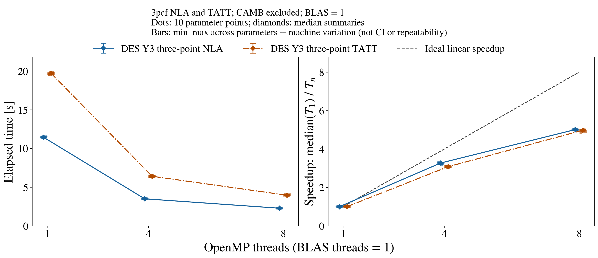

# Three-point OpenMP timings on Apple M2 Pro

1. [Measured results](#results)
2. [What was timed](#interval)
3. [Inputs and checks](#checks)
4. [LSST control and saved records](#records)

## Measured results 

Each number is the median elapsed time over ten different parameter points.
The calculation returns all 80 DES Y3 aperture entries: twenty source triplets
and four filter radii. NLA and TATT use the same cosmological points and
numerical grids. BLAS uses one thread throughout. The machine is an Apple
M2 Pro with twelve physical cores, running macOS.

| Model | Median time, 1 thread | Median time, 4 threads | Median time, 8 threads | Speedup at 4 threads | Speedup at 8 threads |
|---|---:|---:|---:|---:|---:|
| NLA | 11.453 s | 3.502 s | 2.285 s | 3.271 | 5.013 |
| TATT | 19.741 s | 6.415 s | 3.966 s | 3.077 | 4.977 |

Speedup is the one-thread median divided by the median at the chosen team
size. Both models reach about fivefold speedup at eight threads. Going from
four to eight threads reduces median time by factors 1.533 for NLA and 1.617
for TATT. TATT takes about 1.74 times the NLA time at eight threads. These
measurements do not identify the remaining serial work or memory bottleneck;
that requires a separate profile.

[Download the three-point PDF](threepcf_scaling.pdf). Every dot is an actual
parameter-point measurement. Bars show the observed minimum-to-maximum range,
including parameter dependence and machine variation. They are not confidence
intervals or repeated-measurement errors at one cosmology.

## What was timed 

The measured call creates a fresh physical C model, prepares its
cosmology-dependent interpolation tables, projects the bispectrum, performs
the natural-component transforms and integrates the aperture estimator.
It includes the Python input checks and array conversions inside that call.
A changed point therefore does not reuse an unchanged prediction.

CAMB, file reads, library imports, fixed angular geometry and FFT-plan creation
are outside the interval. Each fresh process evaluates a separate warmup
point before the ten recorded points. Blocks run at four, one and then eight
threads, with one process active at a time. A chain's total runtime also
includes its Boltzmann calculation and other likelihood operations.

NLA fixes quadratic IA and velocity-shear amplitudes to zero and omits
preparation of the physical residual IA grid. The configured multipole and
natural-component transform loops remain. TATT activates its quadratic and
density-weighting terms. Both use the same 576-point aligned FFT grid, angular
truncations L=M=20, 64 angular quadrature nodes, 65 line-of-sight nodes and
finite-triangle aperture geometry. The YAML files keep the other settings.

## Inputs and checks 

CAMB solves transfer functions to 5 inverse Mpc. Its power interpolators
extend the tail to 1000 inverse Mpc, filling a saved k axis through
1000 h/Mpc. Unit conversions are explicit. The producer adjusts $`A_s`$,
the primordial scalar amplitude, to the requested $`\sigma_8`$ using
kept matter transfers and recalculates nonlinear power at that amplitude.
TATT reuses NLA's matter tables only after matching their physical inputs
and loaded axes exactly.

All twelve model/data-vector/thread-count blocks passed the runtime check:
the requested maximum OpenMP team was active and every loaded BLAS pool had
one thread. Every point, including each warmup, gives identical float64 bits
at 1, 4 and 8 threads. Consecutive changed points give different vectors.
The saved archive contains 120 measured predictions and twelve warmups.

Forty-six control, plotting, source, cache and configuration checks passed,
along with thirteen CAMB checks. The latter compare transfer reuse against
an independent fresh final-amplitude solve using the opposite CAMB unit API.
Linear, nonlinear and cold-matter powers agree within the stated relative
tolerance $`2\times10^{-10}`$. The strict and debug C checks are in the
[validation record](../../tests/VALIDATION.md).

The timing input clips twelve negative samples in the first source bin and
renormalizes it, recording the removed area and source hash. This is the
stated timing policy; the original FITS file and forecast inputs remain
separate. The grids, tail prescription and finite-triangle geometry have not
established survey-level convergence by passing a timing test, and this
record makes no speed comparison against an original fastnc configuration.

## LSST control and saved records 

LSST Y1 is the control calculation, using its full 1560-entry 3x2pt vector.

| Model | Median time, 1 thread | Median time, 4 threads | Median time, 8 threads |
|---|---:|---:|---:|
| LSST NLA | 0.119672 s | 0.052358 s | 0.044802 s |
| LSST TATT | 0.162751 s | 0.063622 s | 0.051779 s |

The [combined control plot](openmp_scaling.pdf) uses a logarithmic elapsed-time
axis so the shorter LSST durations remain visible. The three-point-only figure
uses a linear axis. These data vectors measure different observables, so
their absolute runtimes do not compare interchangeable algorithms.

The [CSV](timings.csv) contains individual durations; [records.json](records.json)
adds sampled parameters. [summary.json](summary.json) contains medians, ranges
and speedups. The [manifest](manifest.json), [hardware](hardware.json),
[environment](environment.json) and [implementation hashes](implementation_hashes.json)
identify settings, machine, dependencies and copied binary files.
[Runtime records](warmups_and_threads.json) keep the pool checks;
[vectors.npz](vectors.npz) preserves all output arrays with pickle disabled.
[Preparation metadata](threepcf_preparation_metadata.json) records power limits,
source processing and physical-table reuse.

The two measurement groups use different three-point CAMB producers as
inputs. The LSST control timings use the earlier producer; their case
specification does not involve the corrected producer code, and their
rechecked vectors are unchanged. The three-point NLA and TATT timings use
the corrected producer. The
[continuation script](continue_des3pcf_scaling.py) and the manifest record
which producer each block used. Absolute input paths refer to the
measurement machine; the [benchmark guide](../../BENCHMARK.md) gives the
regular CLI commands.
