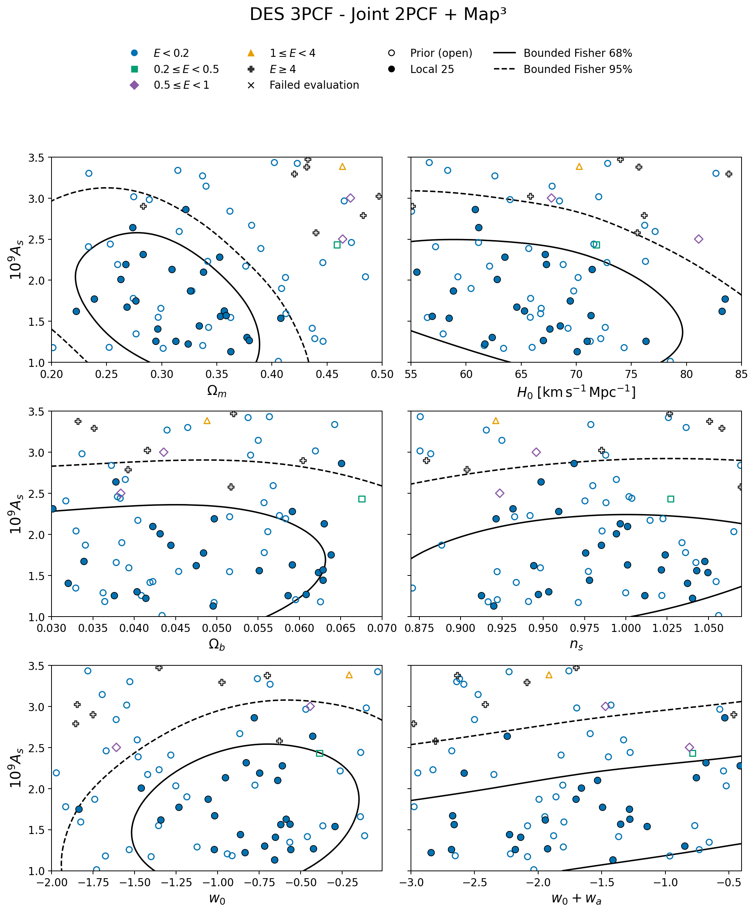

# Physical mean, transform and aperture checks

1. [What the references measure](#measures)
2. [The aperture reference](#reference)
3. [Physical tables and angular transforms](#physics)
4. [The test files](#files)
5. [Running the checks](#running)
6. [Photo-z convention checks](#photoz-conventions)
7. [Hybrid-emulator accuracy test](#hybrid-emulator-accuracy-test)
8. [FoM convergence](#fom-convergence)
9. [Appendix](#appendix)
    1. [FAQ: How do the setting-sequence tests compare a notebook with a fresh process?](#state)
    2. [FAQ: Why do grouped SIMD outputs keep identical bits?](#simd)
    3. [FAQ: How are invalid inputs tested?](#refusals)
    4. [FAQ: What replaced the aperture-reference generator?](#regenerate)

## What the references measure <a name="measures"></a>

Every independent reference in this folder answers one scientific
question about the C implementation:

| Reference | Scientific question |
|---|---|
| Pinned fastnc matter and nineteen IA components | Does the port preserve the upstream formulas and conventions? |
| Eighty-digit squeezed-triangle equations | Does stable double-precision geometry retain terms lost by squared-side cancellation? |
| Cartesian Gaussian shear moments | Are the natural-component signs, phases and ordered Fourier legs correct independently of fastnc? |
| Analytic and independently evaluated Mellin transforms | Are FFTLog normalization, Bessel order, taper and radial-bin averaging correct? |
| Pinned aperture kernels and direct complex contractions | Are unequal radii, mirrored terms, bin measures and component order correct? |

Source agreement is not an independent proof of a source formula. The
squeezed-triangle checks deliberately use unrearranged equations at
eighty digits, with the exact binary inputs that C receives. They cover
side ratios through $`10^{-12}`$, several opening angles, cyclic
relabelings and common power-of-two rescalings. The matter fit retains
its separate source-root accuracy allowance; the geometry tests do not
relax that comparison.

One pinned IA entry describes an intended 3:4:5 triangle and vanishes
analytically. The reference and port can give different signs to its
tiny floating-point remainder. That entry is checked against its
unsubtracted vertex amplitude times a roundoff bound. Every other pinned
IA entry keeps its original tolerance. This is different from increasing
a whole-array absolute tolerance until a discrepancy disappears.

## The aperture reference <a name="reference"></a>

The saved [reference weights](reference_aperture_weights.json) come from
the `_calculateT` method in fastnc commit
`7b2336ce37a909bed51f07f32a2a4f096e71b6ce`. The generator verifies the source
file's SHA256 before extracting that method. It adds the finite SAS bin
measure, mirrored-radius sum and factor one quarter. The file stores every
input coordinate, width and radius, plus its source and NumPy version.

The comparison includes equal and unequal radii, unequal side grids and
nonzero complex weights. The equal-radius upstream branch uses the
simplified Jarvis–Bernstein–Jain expression, while the C implementation
uses the general cyclic formula. Further checks exercise complex
contraction, angular rescaling, changed coordinates with unchanged array
dimensions, noncontiguous notebook inputs and repeated calls.

The reference tolerance is $`2\times10^{-12}`$ relative with an absolute
floor $`2\times10^{-15}`$. This permits rounding differences between the
complex arithmetic expressions while detecting normalization and phase
errors. It is not a survey likelihood tolerance. The stored reference is
never regenerated by the tests, and no generator ships; the appendix
[FAQ: What replaced the aperture-reference generator?](#regenerate)
explains what the saved reference checks.

## Physical tables and angular transforms <a name="physics"></a>

`test_physics_model.py` checks the matter fit, all nineteen active
intrinsic-shape terms, projected baseline/residual separation, NLA power
and full-filter aperture normalization. The saved physical reference
records the pinned fastnc source and conventions. Exact source-reader
comparisons remain separate from production uniform-table refinement.
The latter compares off-node triangles, ordered unequal legs, squeezed
and nearly flattened limits, and signed residuals against direct physical
evaluation. Errors near a zero crossing use a physical amplitude scale
instead of dividing by a vanishing answer.

The transform tests compare angular coupling with its defining integral,
two-Bessel transforms with analytic and independently evaluated Mellin
references, and the shear rotations with Cartesian Gaussian moments.
Unequal ordered TATT legs exercise both signs of angular mode. High-order
tests compare the Gamma recurrence with direct complex log-Gamma values,
including orders 97 and 103. Selected output bins, padding, radial-bin
averaging, windows, array ownership and worker counts have separate checks.

These tests establish the tested formulas and numerical transformations.
They do not fix a universal number of angular modes, Fourier nodes or
triangle samples for DES. The
[numerical guide](../../../../external_modules/code/cosmolike_core/cosmolike/3pcf/NUMERICS.md)
explains which controls must be refined independently.

## The test files <a name="files"></a>

| Test file | Calculation checked |
|---|---|
| `test_physics_model.py` | Matter fit, the nineteen intrinsic-shape terms, baseline/residual separation, NLA power and aperture normalization against analytic limits and the pinned fastnc reference. |
| `test_physics_squeezed.py` | Squeezed-triangle geometry against eighty-digit, unrearranged Decimal equations. |
| `test_ia_components.py` | Physical IA operators independently and through the aperture integral, including the equilateral torque-to-tensor identity. |
| `test_signed_baseline.py` | Signed NLA tables against direct radial projections, including a negative projected baseline. |
| `test_residual_scaling.py` | The signed TATT residual after dividing by the positive equal-side gravitational amplitude. |
| `test_shape_stretch.py` | The optional stretched PUV shape coordinate at well-conditioned coarse knots, with direct radial projection as the reference. |
| `test_mixed_psi_coordinate.py` | The mixed angular chart x = log ψ + ψ/s: physical-angle arrays versus interpolation cells, against an independent angular integral. |
| `test_pixel_window.py` | Three-leg pixel-window smoothing, input ownership and its sharp angular support. |
| `test_transform.py` | Angular and FFTLog transforms against NumPy/SciPy Mellin references and direct integration of the coupling integral. |
| `test_transform_physics.py` | Spin phases and normalization against exact polynomial-Gaussian moments of an analytic scalar bispectrum. |
| `test_transform_mode_schedule.py` | Bitwise ownership of the smallest angular-mode schedules, including the shared M = ±1 inverse transforms. |
| `test_aperture.py` | Finite-grid aperture weights against the pinned external kernel, plus complex multiplication, layout and linearity. |
| `test_combined_projection_modes.py` | Simultaneous signed-baseline and scaled-residual preparation keeps each GGG table with its source labels. |
| `test_grid_transform_reuse.py` | Which state a reused projected-grid interpolation map may keep, and which changes require a new map. |
| `test_multipole_lane_invariance.py` | Read the same multipole coefficient after adding a query or retaining another Legendre order. |
| `test_physics_lane_invariance.py` | Keep a projected triplet, angular order, NLA power coordinate or aperture filter while adding a neighboring output. |
| `test_physics_setting_sequences.py` | Notebook state transitions of the physical model compared bit for bit with fresh interpreters. |
| `test_transform_setting_sequences.py` | Long-lived transform/aperture state compared with fresh Python processes. |
| `test_physics_refusal.py` | Unsupported geometry and labels are refused before lossy conversions. |
| `test_transform_refusal.py` | Invalid transform inputs terminate before unaligned reads or FFT calls. |
| `test_feedback.py` | Paired matter feedback responses with exact constant-response predictions and the fixed-quadratic-IA approximation the model declares. |
| `test_baryon_scenarios.py` | Physical feedback preparation and the installed paired BACCO API: normalization, cold/total amplitude, triangle and ordering mistakes. |
| `test_bacco_feedback.py` | The BACCO neutrino closure, continuation and dynamic response cache, with analytic component sums. |
| [test_photoz_conventions.py](test_photoz_conventions.py) | Change the native reader of the prepared source redshifts and compare the cosmic-shear and joint predictions. |

The lane-invariance pair tests whether the numerical answer depends on
how unrelated outputs are grouped for SIMD. Each comparison preserves
the physical nodes and weights; only the output request changes, and the
result is required to match bitwise, including signed zero. The NLA
cases also pair a valid interpolation coordinate with an extrapolated
coordinate; the valid read must retain the same arithmetic. These are
rounding and indexing checks; changing integration resolution would
require an accuracy comparison instead of bitwise equality. The appendix
[FAQ: Why do grouped SIMD outputs keep identical bits?](#simd)
explains the compiler mechanism.

## Running the checks <a name="running"></a>

Use the [test environment](../README.md#running): BLAS has one thread,
OpenMP has at most four, and only one test process runs at a time. Set the
environment before Python starts; child processes inherit it.

**Step :one:**: run from an activated `Cocoa/` directory.

```bash
python -m pytest -q projects/des_3pcf/tests/data_vector
```

## Photo-z convention checks <a name="photoz-conventions"></a>

[**Mechanism**](https://github.com/CosmoLike/cocoa-cosmolike-core/blob/main/README.md#dv_photoz).
The source redshift file gives bin midpoints. The likelihood uses
shape-preserving cubic interpolation (PCHIP) to reconstruct the shifted
curves on a uniform 9,601-point grid. The cosmic-shear projection reads
this grid with the native linear interpolator and treats its redshifts
as sample points. Map3 uses the reconstructed grid directly.

The test uses the uncompressed joint vector at the fiducial point of
`EXAMPLE_EVALUATE3.yaml`. It changes the native cosmic-shear reader to a
cubic spline, Steffen interpolation or a left-edge reading. The
reconstructed curves and all 80 Map3 entries must remain identical.
Restoring the default after each change
must reproduce the joint vector bit for bit. The test measures Δχ²
using the marginal covariance of the 400 shear entries, then using the
full 480-entry covariance including the shear–Map3 correlations.

| Native reader change | Shear Δχ² | Joint Δχ² |
| --- | ---: | ---: |
| Cubic spline | 1.8×10⁻⁹ | 2.8×10⁻⁹ |
| Steffen | 2.3×10⁻⁹ | 3.6×10⁻⁹ |
| Left edges | 8×10⁻⁴ | 1.3×10⁻³ |

The left-edge interpretation moves the native samples by half a grid
interval and produces the largest difference.

Run from the activated `Cocoa/` directory.

**Step :one:** Set the thread counts.

- Linux

      export OMP_NUM_THREADS=1 COCOA_TEST_OMP_THREADS=2 OMP_DYNAMIC=FALSE \
        OMP_PROC_BIND=close OMP_PLACES=cores \
        OPENBLAS_NUM_THREADS=1 OPENBLAS_DEFAULT_NUM_THREADS=1 \
        MKL_NUM_THREADS=1 VECLIB_MAXIMUM_THREADS=1

- macOS (arm)

      export OMP_NUM_THREADS=1 COCOA_TEST_OMP_THREADS=2 OMP_DYNAMIC=FALSE \
        OMP_PROC_BIND=disabled OMP_PLACES=cores \
        OPENBLAS_NUM_THREADS=1 OPENBLAS_DEFAULT_NUM_THREADS=1 \
        MKL_NUM_THREADS=1 VECLIB_MAXIMUM_THREADS=1

BLAS loads with the one-thread cap. The prediction requests two native
OpenMP threads.

**Step :two:** Run the photo-z check.

```bash
python -m pytest -s projects/des_3pcf/tests/data_vector/test_photoz_conventions.py
```

## Hybrid-emulator accuracy test

**Mechanism.** Compare the candidate emulator's predictions with CAMB at
the same saved cosmologies and nuisance values. Score the prediction
differences using the benchmark mask and covariance.

The observed joint vector contains 16 MOPED shear modes and 80 Map3
measurements. The likelihood requests linear cold power. For CPL, the
candidate rescales Eisenstein–Hu growth by the square root of the ratio
of linear power in the CPL cosmology to its matched ΛCDM cosmology at
$k=0.05\,\mathrm{Mpc}^{-1}$.

<!-- hybrid-emulator figure -->
**Emulator training range**

| Parameter | Range |
| --- | --- |
| Total matter density | 0.2 < Ωm < 0.5 |
| Primordial amplitude | 1 < 10⁹ Aₛ ≤ 3.5 |
| Hubble constant | H₀ < 85 km/s/Mpc |
| Present dark-energy equation of state | w₀ > −2 |
| Early-time dark-energy equation of state | w₀ + wₐ < −0.4 |
| Physical baryon density | Ωb (H₀ / 100)² < 0.035 |

The fixed model tables intersect these limits with the project priors.
3/50 broad and 0/25 focused points extend beyond the common observed
$n_s$ extrema of the two installed scalers. These are coordinate bounds.

CAMB uses one massive neutrino at 0.06 eV, `AccuracyBoost: 1.0`,
`k_per_logint: 0` and `kmax: 5.0`.
The broad table provides cosmological and nuisance coordinates. The focused
table holds nuisances at the benchmark fiducial.

The comparison scores the squared prediction difference with the joint data
precision, $E=(d_{\rm emul}-d_{\rm CAMB})^\mathsf{T}C^{-1}(d_{\rm emul}-d_{\rm CAMB})$.
The plot shows 50 broad draws as open symbols and 25 focused draws as filled
symbols. Solid and dashed curves enclose 68% and 95% of the saved bounded,
nuisance-marginalized Fisher distribution.



Counts use the strict thresholds 0.2, 0.5, 1 and 4 in that order.

| Case | Broad below threshold (50) | Focused below threshold (25) | Nonfinite broad/focused |
| --- | --- | --- | --- |
| Joint 2PCF + Map³ | 39/40/42/43 | 25/25/25/25 | 0/0 |

The broad maximum was $E=27417.01$ at draw 43 ($w_0=-0.975$, $w_a=-1.114$,
$\Omega_m=0.420$). The Map3 rows contributed 99.99% to the sum
$\sum_j \delta d_j(C^{-1}\delta d)_j$ with the joint precision, which includes
cross-probe terms. The largest focused error was $E=0.01074$.

<!-- end hybrid-emulator figure -->

The [frozen CPL inputs](../fisher_reference/w0wa/) record both tables, numerical
settings, mask, priors and ordinary CAMB Fisher geometry. The local run keeps
[broad results](../../chains/hybrid_emulator_tests/ordinary_accuracy_2x4_20261125-w0pwa_m0p4-w0wa/summary.txt) and [focused results](../../chains/hybrid_emulator_tests/ordinary_accuracy_2x4_20261125-w0pwa_m0p4-w0wa/local/summary.txt),
including the input settings and both model vectors.

E5 treats large prediction errors as advisory. Missing CAMB predictions or
absence of any valid candidate comparison fail the test. Run from activated
Cocoa.

```bash
python -m pytest projects/des_3pcf/tests/data_vector/test_emul2.py -k e5
```

For MPI, run from the main `Cocoa/` directory with the environment activated.

**Step :one:** Set four OpenMP threads and one BLAS thread per rank.

- Linux

      export OMP_NUM_THREADS=4 OMP_DYNAMIC=FALSE \
        OMP_PROC_BIND=close OMP_PLACES=cores OPENBLAS_NUM_THREADS=1 \
        OPENBLAS_DEFAULT_NUM_THREADS=1 MKL_NUM_THREADS=1 VECLIB_MAXIMUM_THREADS=1

- macOS (arm)

      export OMP_NUM_THREADS=4 OMP_DYNAMIC=FALSE \
        OMP_PROC_BIND=disabled OMP_PLACES=cores OPENBLAS_NUM_THREADS=1 \
        OPENBLAS_DEFAULT_NUM_THREADS=1 MKL_NUM_THREADS=1 VECLIB_MAXIMUM_THREADS=1

**Step :two:** Run the comparison with two MPI ranks.

- Linux

      "${CONDA_PREFIX}"/bin/mpirun -n 2 --oversubscribe \
        --mca pml ob1 --mca btl vader,tcp,self \
        --bind-to core:overload-allowed --map-by numa:pe="${OMP_NUM_THREADS}" \
        python -m mpi4py \
        projects/des_3pcf/tests/compare_emulator_camb.py --mpi --advisory

- macOS (arm)

      mpirun -n 2 --bind-to none python -m mpi4py \
        projects/des_3pcf/tests/compare_emulator_camb.py --mpi --advisory

Use `--plot-only /path/to/run` to redraw a completed result. The
[archived ΛCDM figure](figures/emulator_precision.png) and
[its benchmark inputs](../fisher_reference/) describe the earlier experiment.

## FoM convergence <a name="fom-convergence"></a>

This CAMB test uses the ordinary accuracy and physical prescription of each
benchmark to build one full local Fisher matrix. The figure of merit is
$`1/\sqrt{\det C_{w_0,w_a}}`$, with nuisance parameters marginalized in the
Gaussian approximation. The sampled pair $`w_0,w_0+w_a`$ has the same ellipse
area. Gaussian prior curvature enters the Fisher matrix, and prior bounds
limit the stencil positions.

**Mechanism.** The test computes every derivative at the default
settings. To estimate numerical noise it takes fourth differences of the
five predictions used for each derivative. The step is 2.5% for nonzero
parameter values, shortened at prior boundaries. For a zero-centered
parameter it uses the specified absolute step or one tenth of its
proposal width.

The estimate treats the derivative errors as centered and uncorrelated.

```math
F_q \simeq F_0 + \operatorname{diag}(a_q), \qquad S_q = F_q^{-1}.
```

Here $`F_0`$ is the full default Fisher matrix, and each entry in
$`a_q`$ is a fourth-difference estimate of the noise for one selected
derivative at setting $`q`$, weighted by the inverse data covariance. The FoM
uses the dark-energy block of $`S_q`$. Both refinements reevaluate the
same selected derivatives. Their noise estimates use the same selection
at the default and higher settings. Noise in the other derivatives and
smooth shifts of any derivative remain unmeasured.

CAMB supplies the cold-matter spectrum for [the saved CPL benchmark](../fisher_reference/w0wa/benchmark.yaml).

The trials use triangle boosts 1.25 and 1.5 and hold CAMB and two-point
settings fixed. An earlier study with uncompressed NLA vectors found a
−6.7% shift from replacing four derivative columns at triangle boost
1.5. The fourth-difference estimate for those columns was +1.7×10⁻³%.
Smooth derivative changes can affect the FoM even when the numerical
jitter estimate is small. [Earlier accuracy study](../studies/fisher_accuracy_validation.md)

| Setting | Default | Higher | Highest |
| --- | ---: | ---: | ---: |
| CosmoLike `accuracyboost` | 1 | 1 | 1 |
| CosmoLike `integration_accuracy` | 0 | 0 | 0 |
| CAMB `AccuracyBoost` | 1 | 1 | 1 |
| CAMB `k_per_logint` | 0 | 0 | 0 |
| Map3 `triangle_boost` | 1 | 1.25 | 1.5 |

The entries are estimated FoM changes between successive settings.

| Likelihood | Default → higher | Higher → highest |
| --- | ---: | ---: |
| Joint cosmic shear and Map3 | +3.8×10⁻⁴% | +1.0×10⁻³% |

The default Map3 settings meet the 1% check for this estimate. Both
successive changes are below 1% when raising the triangle boost.

**Selected columns in both higher settings**

- Joint cosmic shear and Map3 — `H0`, `omegam`, `omegab`, `w`, `w0pwa`.

Run from the main `Cocoa/` directory with the Cocoa environment activated.

**Step :one:** Set four OpenMP threads and one BLAS thread per rank.

- Linux

      export OMP_NUM_THREADS=4 OMP_DYNAMIC=FALSE \
        OMP_PROC_BIND=close OMP_PLACES=cores \
        OPENBLAS_NUM_THREADS=1 \
          OPENBLAS_DEFAULT_NUM_THREADS=1 MKL_NUM_THREADS=1 VECLIB_MAXIMUM_THREADS=1

- macOS (arm)

      export OMP_NUM_THREADS=4 OMP_DYNAMIC=FALSE \
        OMP_PROC_BIND=disabled OMP_PLACES=cores \
        OPENBLAS_NUM_THREADS=1 \
          OPENBLAS_DEFAULT_NUM_THREADS=1 MKL_NUM_THREADS=1 VECLIB_MAXIMUM_THREADS=1

**Step :two:** Run the check with two MPI ranks.

- Linux

      "${CONDA_PREFIX}"/bin/mpirun -n 2 --oversubscribe \
        --mca pml ob1 --mca btl vader,tcp,self \
        --bind-to core:overload-allowed --map-by numa:pe="${OMP_NUM_THREADS}" \
        python -m mpi4py projects/des_3pcf/tests/check_fom_convergence.py --mpi

- macOS (arm)

      mpirun -n 2 --bind-to none python -m mpi4py \
        projects/des_3pcf/tests/check_fom_convergence.py --mpi

The run directory contains `fisher/fom_accuracy.tsv`, the effective
settings, and the measured and omitted columns.

## Appendix <a name="appendix"></a>

## :interrobang: FAQ: How do the setting-sequence tests compare a notebook with a fresh process? <a name="state"></a>

A reused object is compared with a separate process configured directly
at the requested state. The physical-model checks contain 150 such
references, the transform/aperture checks 66, and the physical-covariance
checks of `../covariance/` 82. They grow and shrink dimensions, change
coordinates without changing sizes, interleave models they keep alive, restore
earlier settings and mutate caller or returned arrays. Identical
operations require identical float64 bits.

The project checks also change IA parameters, source shifts, calibration,
physical-table settings and global/stage accuracy controls behind the
outer Fisher cache. Changing a count must affect the intended stage
before its invalidation test can be considered informative. The ordinary
two-point bridge restores the state it declares after raw notebook calls and
refuses partial edits to its prepared settings.

## :interrobang: FAQ: Why do grouped SIMD outputs keep identical bits? <a name="simd"></a>

Strict floating-point flags alone do not remove one compiler
distinction: a scalar multiply-add can round once while explicit SIMD
products and sums round separately. The affected covariance and
multipole tails therefore use local rounding boundaries, so a value
computed in a vector lane and the same value computed in a scalar tail
round identically. Covariance tests add zero-measure nodes; multipole
tests append an unused query or keep one more Legendre order. These
operations move an existing output between scalar and vector paths
without changing its equation, and the outputs must retain identical
bits.

The physical projection checks apply the same criterion to
source-triplet, direct-multipole, NLA power and aperture-filter batches.
Both adapters and both power-reader conventions are exercised;
quadrature weights and nodes remain fixed in each comparison.

## :interrobang: FAQ: How are invalid inputs tested? <a name="refusals"></a>

Workspace dimensions enter checked `size_t` multiplication before
allocation. Notebook integer source labels are checked before conversion
to int32, so fractional values cannot be truncated into apparently valid
bin labels. Malformed-input tests require the intended diagnostic and
exit status in a child process; a loader failure or unrelated traceback
cannot pass them.

## :interrobang: FAQ: What replaced the aperture-reference generator? <a name="regenerate"></a>

The frozen [reference weights](reference_aperture_weights.json) are the
reference. The file records its source commit
(`7b2336ce37a909bed51f07f32a2a4f096e71b6ce`), every input coordinate,
width and radius, and the NumPy version, and the tests read it without
running fastnc. The generator that extracted the upstream `_calculateT`
method was retired with the rule that this project never imports or runs
the codes it was ported from; it remains in Git history. A changed
reference requires an explained source or convention change; it must not
hide a failed C comparison. The core module keeps the source notices.
