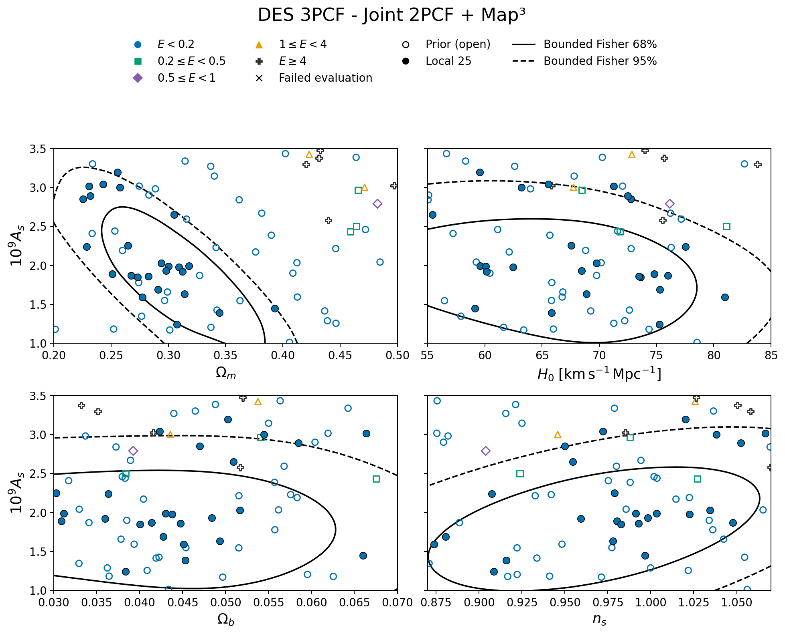

# Physical mean, transform and aperture checks

1. [What the references measure](#measures)
2. [The aperture reference](#reference)
3. [Physical tables and angular transforms](#physics)
4. [The test files](#files)
5. [Running the checks](#running)
6. [Hybrid-emulator accuracy test](#hybrid-emulator-accuracy-test)
7. [FoM convergence](#fom-convergence)
8. [Appendix](#appendix)
    1. [FAQ: How do the setting-sequence tests compare a notebook with a fresh process?](#state)
    2. [FAQ: Why do grouped SIMD outputs keep identical bits?](#simd)
    3. [FAQ: How are invalid inputs tested?](#refusals)
    4. [FAQ: What replaced the aperture-reference generator?](#regenerate)

## What the references measure <a name="measures"></a>

Every independent reference in this folder answers one scientific
question about the C implementation:

| Reference | Scientific question |
|---|---|
| Pinned fastnc matter and nineteen IA components | Does the port preserve the upstream formulas and conventions? |
| Eighty-digit squeezed-triangle equations | Does stable double-precision geometry retain terms lost by squared-side cancellation? |
| Cartesian Gaussian shear moments | Are the natural-component signs, phases and ordered Fourier legs correct independently of fastnc? |
| Analytic and independently evaluated Mellin transforms | Are FFTLog normalization, Bessel order, taper and radial-bin averaging correct? |
| Pinned aperture kernels and direct complex contractions | Are unequal radii, mirrored terms, bin measures and component order correct? |

Source agreement is not an independent proof of a source formula. The
squeezed-triangle checks deliberately use unrearranged equations at
eighty digits, with the exact binary inputs that C receives. They cover
side ratios through $`10^{-12}`$, several opening angles, cyclic
relabelings and common power-of-two rescalings. The matter fit retains
its separate source-root accuracy allowance; the geometry tests do not
relax that comparison.

One pinned IA entry describes an intended 3:4:5 triangle and vanishes
analytically. The reference and port can give different signs to its
tiny floating-point remainder. That entry is checked against its
unsubtracted vertex amplitude times a roundoff bound. Every other pinned
IA entry keeps its original tolerance. This is different from increasing
a whole-array absolute tolerance until a discrepancy disappears.

## The aperture reference <a name="reference"></a>

The saved [reference weights](reference_aperture_weights.json) come from
the `_calculateT` method in fastnc commit
`7b2336ce37a909bed51f07f32a2a4f096e71b6ce`. The generator verifies the source
file's SHA256 before extracting that method. It adds the finite SAS bin
measure, mirrored-radius sum and factor one quarter. The file stores every
input coordinate, width and radius, plus its source and NumPy version.

The comparison includes equal and unequal radii, unequal side grids and
nonzero complex weights. The equal-radius upstream branch uses the
simplified Jarvis–Bernstein–Jain expression, while the C implementation
uses the general cyclic formula. Further checks exercise complex
contraction, angular rescaling, changed coordinates with unchanged array
dimensions, noncontiguous notebook inputs and repeated calls.

The reference tolerance is $`2\times10^{-12}`$ relative with an absolute
floor $`2\times10^{-15}`$. This permits rounding differences between the
complex arithmetic expressions while detecting normalization and phase
errors. It is not a survey likelihood tolerance. The stored reference is
never regenerated by the tests, and no generator ships; the appendix
[FAQ: What replaced the aperture-reference generator?](#regenerate)
explains the frozen fixture's role.

## Physical tables and angular transforms <a name="physics"></a>

`test_physics_model.py` checks the matter fit, all nineteen active
intrinsic-shape terms, projected baseline/residual separation, NLA power
and full-filter aperture normalization. The saved physical reference
records the pinned fastnc source and conventions. Exact source-reader
comparisons remain separate from production uniform-table refinement.
The latter compares off-node triangles, ordered unequal legs, squeezed
and nearly flattened limits, and signed residuals against direct physical
evaluation. Errors near a zero crossing use a physical amplitude scale
instead of dividing by a vanishing answer.

The transform tests compare angular coupling with its defining integral,
two-Bessel transforms with analytic and independently evaluated Mellin
references, and the shear rotations with Cartesian Gaussian moments.
Unequal ordered TATT legs exercise both signs of angular mode. High-order
tests compare the Gamma recurrence with direct complex log-Gamma values,
including orders 97 and 103. Selected output bins, padding, radial-bin
averaging, windows, array ownership and worker counts have separate checks.

These tests establish the tested formulas and numerical transformations.
They do not fix a universal number of angular modes, Fourier nodes or
triangle samples for DES. The
[numerical guide](../../../../external_modules/code/cosmolike_core/cosmolike/3pcf/NUMERICS.md)
explains which controls must be refined independently.

## The test files <a name="files"></a>

| Test file | Calculation checked |
|---|---|
| `test_physics_model.py` | Matter fit, the nineteen intrinsic-shape terms, baseline/residual separation, NLA power and aperture normalization against analytic limits and the pinned fastnc reference. |
| `test_physics_squeezed.py` | Squeezed-triangle geometry against eighty-digit, unrearranged Decimal equations. |
| `test_ia_components.py` | Physical IA operators independently and through the aperture integral, including the equilateral torque-to-tensor identity. |
| `test_signed_baseline.py` | Signed NLA tables against direct radial projections, including a negative projected baseline. |
| `test_residual_scaling.py` | The signed TATT residual after dividing by the positive equal-side gravitational amplitude. |
| `test_shape_stretch.py` | The optional stretched PUV shape coordinate at well-conditioned coarse knots, with direct radial projection as the reference. |
| `test_mixed_psi_coordinate.py` | The mixed angular chart $`x=\log\psi+\psi/s`$: physical-angle arrays versus interpolation cells, against an independent angular integral. |
| `test_pixel_window.py` | Three-leg pixel-window smoothing, input ownership and its sharp angular support. |
| `test_transform.py` | Angular and FFTLog transforms against NumPy/SciPy Mellin references and direct integration of the coupling integral. |
| `test_transform_physics.py` | Spin phases and normalization against exact polynomial-Gaussian moments of an analytic scalar bispectrum. |
| `test_transform_mode_schedule.py` | Bitwise ownership of the smallest angular-mode schedules, including the shared $`M=\pm1`$ inverse transforms. |
| `test_aperture.py` | Finite-grid aperture weights against the pinned external kernel, plus complex multiplication, layout and linearity. |
| `test_combined_projection_modes.py` | Simultaneous signed-baseline and scaled-residual preparation keeps each GGG table with its source labels. |
| `test_grid_transform_reuse.py` | Which state a reused projected-grid interpolation map may keep, and which changes require a new map. |
| `test_multipole_lane_invariance.py` | Read the same multipole coefficient after adding a query or retaining another Legendre order. |
| `test_physics_lane_invariance.py` | Keep a projected triplet, angular order, NLA power coordinate or aperture filter while adding a neighboring output. |
| `test_physics_setting_sequences.py` | Notebook state transitions of the physical model compared bit for bit with fresh interpreters. |
| `test_transform_setting_sequences.py` | Long-lived transform/aperture state compared with fresh Python processes. |
| `test_physics_refusal.py` | Unsupported geometry and labels are refused before lossy conversions. |
| `test_transform_refusal.py` | Invalid transform inputs terminate before unaligned reads or FFT calls. |
| `test_feedback.py` | Paired matter feedback responses with exact constant-response predictions and the fixed-quadratic-IA approximation the model declares. |
| `test_baryon_scenarios.py` | Physical feedback preparation and the installed paired BACCO API: normalization, cold/total amplitude, triangle and ordering mistakes. |
| `test_bacco_feedback.py` | The BACCO neutrino closure, continuation and dynamic response cache, with analytic component sums. |

The lane-invariance pair tests whether the numerical answer depends on
how unrelated outputs are grouped for SIMD. Each comparison preserves
the physical nodes and weights; only the output request changes, and the
result is required to match bitwise, including signed zero. The NLA
cases also pair a valid interpolation coordinate with an extrapolated
coordinate; the valid read must retain the same arithmetic. These are
rounding and indexing checks; changing integration resolution would
require an accuracy comparison instead of bitwise equality. The appendix
[FAQ: Why do grouped SIMD outputs keep identical bits?](#simd)
explains the compiler mechanism.

## Running the checks <a name="running"></a>

Use the [test environment](../README.md#running): BLAS has one thread,
OpenMP has at most four, and only one test process runs at a time. Set the
environment before Python starts; child processes inherit it.

**Step :one:**: run from an activated `Cocoa/` directory.

```bash
python -m pytest -q projects/des_3pcf/tests/data_vector
```

## Hybrid-emulator accuracy test

The [CPL benchmark](../fisher_reference/w0wa/) retains the observed joint
selection and varies both dark-energy coordinates with $w_0+w_a<-0.4$.
The likelihood requires
linear cold-matter power. The installed candidate's Eisenstein–Hu provider
supports that field only at $w_0=-1$ and $w_a=0$, so the CPL comparison
awaits validated cold-power support.

### Archived ΛCDM comparison

The results and commands below use the archived $w_0=-1$, $w_a=0$ inputs.

<!-- hybrid-emulator figure -->
**Emulator training range**

| Parameter | Range |
| --- | --- |
| Total matter density | $0.2<\Omega_m<0.5$ |
| Primordial amplitude | $1<10^9 A_s\le 3.5$ |
| Hubble constant | $H_0<85$ km/s/Mpc |
| Present dark-energy equation of state in CPL | $w_0>-2$ |
| Physical baryon density | $\Omega_b(H_0/100)^2<0.035$ |

The fixed tables intersect this range with the benchmark priors. CAMB uses
one massive species with $\sum m_\nu=0.06$ eV. Both model routes evaluate
the same 50 broad points (open symbols) and 25 focused points (filled symbols).
The solid and dashed curves show the saved 68% and 95%
nuisance-marginalized Fisher regions.

CAMB uses `AccuracyBoost: 1.0`, `k_per_logint: 0` and `kmax: 5.0`.



Counts use the thresholds 0.2, 0.5, 1 and 4 in that order.

| Case | Broad below threshold (50) | Focused below threshold (25) | Nonfinite broad/focused |
| --- | --- | --- | --- |
| DES 3PCF | 39/42/43/45 | 25/25/25/25 | 0/0 |

<!-- end hybrid-emulator figure -->

E5 reads the saved `benchmark.yaml` in [fisher_reference/](../fisher_reference/).
The benchmark fixes the likelihood, data selection, sampled parameters,
fiducial and normal numerical controls.

The accuracy test evaluates CAMB and the candidate at the fixed
[50 broad and 25 focused points](../fisher_reference/) and stores both
vectors, the covariance-weighted error, and point status. Nuisance inputs are
held at the evaluate fiducial. Missing CAMB predictions or a comparison
with no valid vectors fails E5. The E5 adapter treats large prediction errors
as advisory. The strict standalone command also checks the error threshold.

```bash
python -m pytest projects/des_3pcf/tests/data_vector/test_emul2.py -k e5
```

To distribute the numerical comparisons across two MPI ranks with four
OpenMP threads each, use the same driver directly from activated Cocoa.
Keep BLAS at one thread and pass `--mpi` so the ranks own different points.

```bash
OMP_NUM_THREADS=4 OPENBLAS_NUM_THREADS=1 MKL_NUM_THREADS=1 \
  VECLIB_MAXIMUM_THREADS=1 mpirun -n 2 --bind-to none python -m mpi4py \
  projects/des_3pcf/tests/compare_emulator_camb.py --mpi --advisory
```

The shared plot uses saved 68% and 95% bounded Fisher contours with
nuisance parameters marginalized. The reference records the matrix, priors,
fiducial and data selection. Use `--fisher-reference` to select a saved
reference directory or `--no-fisher` to show only the comparison points.
Use `EMULATOR_CODE_DIR` and `EMULATOR_DATA_DIR` to select the candidate
network installation.

```bash
python projects/des_3pcf/tests/compare_emulator_camb.py --plot-only /path/to/run
```

## FoM convergence

This CAMB test uses the ordinary accuracy and physical prescription of each
benchmark to build one full local Fisher matrix. The figure of merit is
$1/\sqrt{\det C_{w_0,w_a}}$, with nuisance parameters marginalized in the
Gaussian approximation. The sampled pair $w_0,w_0+w_a$ has the same ellipse
area. Gaussian prior curvature enters the Fisher matrix, and prior bounds
limit the stencil positions.

The five-point stencil uses a fixed 2.5% relative step, shortened near prior
bounds. A zero-centered parameter uses its specified absolute step or one
tenth of its proposal width. The fourth differences rank the numerical
sensitivity of the columns. Both higher settings reevaluate the same selected
columns and use the same full ordinary Fisher weights. The reported values
scale the ordinary FoM by each selected-column noise estimate. Contributions
from omitted columns, smooth derivative shifts and correlated numerical
errors remain unknown.

CAMB supplies the cold-matter spectrum for [the saved CPL benchmark](../fisher_reference/w0wa/benchmark.yaml).

The trials use triangle boosts 1.25 and 1.5 and hold CAMB and two-point
settings fixed. An earlier study with uncompressed NLA vectors found a
$-6.72\%$ shift from replacing four derivative columns at triangle boost
1.5. The fourth-difference estimate for those columns was $+0.00174\%$.
Smooth derivative changes can affect the FoM even when the numerical
jitter estimate is small. [Earlier accuracy study](../studies/fisher_accuracy_validation.md)

| Case | Setting | CosmoLike boost / integration | CAMB boost / k_per_logint | Map3 triangle boost | Approx. FoM | Change from previous |
| --- | --- | --- | --- | --- | --- | --- |
| Joint cosmic shear and Map3 | Ordinary | 1.0 / 0 | 1.0 / 0 | 1 | 0.063233813 | — |
| Joint cosmic shear and Map3 | Refined | 1.0 / 0 | 1.0 / 0 | 1.25 | 0.063234053 | +0.000380302% |
| Joint cosmic shear and Map3 | Confirmation | 1.0 / 0 | 1.0 / 0 | 1.5 | 0.063234705 | +0.00103094% |

**Selected columns in both higher settings**

- Joint cosmic shear and Map3 — `H0`, `omegam`, `omegab`, `w`, `w0pwa`.

Run from activated Cocoa with two MPI ranks, four OpenMP threads per rank
and one BLAS thread.

```bash
OMP_NUM_THREADS=4 OPENBLAS_NUM_THREADS=1 MKL_NUM_THREADS=1 \
  VECLIB_MAXIMUM_THREADS=1 mpirun -n 2 --bind-to none python -m mpi4py \
  projects/des_3pcf/tests/check_fom_convergence.py --mpi
```

The run directory contains `fisher/fom_accuracy.tsv`, the effective
settings for each tier, and the measured and omitted columns. The standalone
screen applies its 1% tolerance to the estimated refined-to-confirmation change.

## Appendix <a name="appendix"></a>

## :interrobang: FAQ: How do the setting-sequence tests compare a notebook with a fresh process? <a name="state"></a>

A reused object is compared with a separate process configured directly
at the requested state. The physical-model checks contain 150 such
references, the transform/aperture checks 66, and the physical-covariance
checks of `../covariance/` 82. They grow and shrink dimensions, change
coordinates without changing sizes, interleave models they keep alive, restore
earlier settings and mutate caller or returned arrays. Identical
operations require identical float64 bits.

The project checks also change IA parameters, source shifts, calibration,
physical-table settings and global/stage accuracy controls behind the
outer Fisher cache. Changing a count must affect the intended stage
before its invalidation test can be considered informative. The ordinary
two-point bridge restores the state it declares after raw notebook calls and
refuses partial edits to its prepared settings.

## :interrobang: FAQ: Why do grouped SIMD outputs keep identical bits? <a name="simd"></a>

Strict floating-point flags alone do not remove one compiler
distinction: a scalar multiply-add can round once while explicit SIMD
products and sums round separately. The affected covariance and
multipole tails therefore use local rounding boundaries, so a value
computed in a vector lane and the same value computed in a scalar tail
round identically. Covariance tests add zero-measure nodes; multipole
tests append an unused query or keep one more Legendre order. These
operations move an existing output between scalar and vector paths
without changing its equation, and the outputs must retain identical
bits.

The physical projection checks apply the same criterion to
source-triplet, direct-multipole, NLA power and aperture-filter batches.
Both adapters and both power-reader conventions are exercised;
quadrature weights and nodes remain fixed in each comparison.

## :interrobang: FAQ: How are invalid inputs tested? <a name="refusals"></a>

Workspace dimensions enter checked `size_t` multiplication before
allocation. Notebook integer source labels are checked before conversion
to int32, so fractional values cannot be truncated into apparently valid
bin labels. Malformed-input tests require the intended diagnostic and
exit status in a child process; a loader failure or unrelated traceback
cannot pass them.

## :interrobang: FAQ: What replaced the aperture-reference generator? <a name="regenerate"></a>

The frozen [reference weights](reference_aperture_weights.json) are the
reference. The file records its source commit
(`7b2336ce37a909bed51f07f32a2a4f096e71b6ce`), every input coordinate,
width and radius, and the NumPy version, and the tests read it without
running fastnc. The generator that extracted the upstream `_calculateT`
method was retired with the rule that this project never imports or runs
the codes it was ported from; it remains in Git history. A changed
reference requires an explained source or convention change; it must not
hide a failed C comparison. The core module keeps the source notices.
