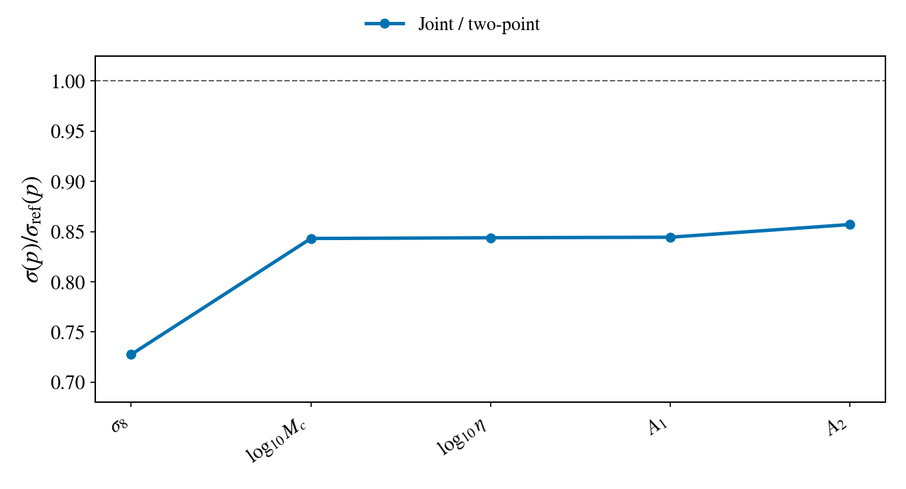
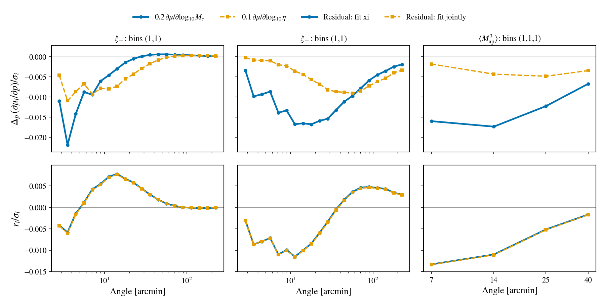
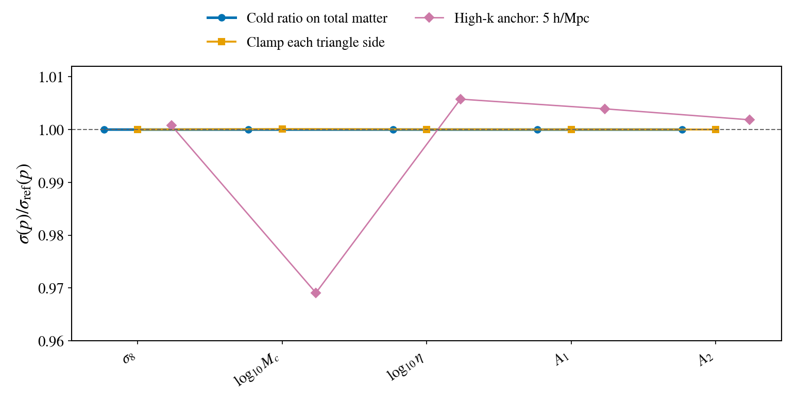
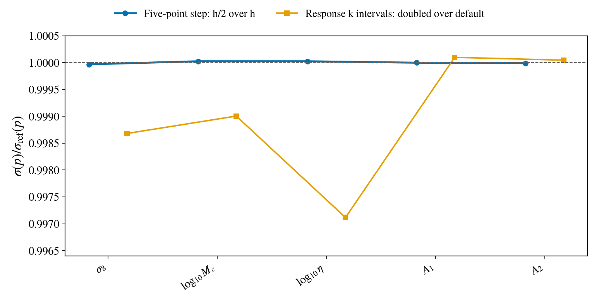

# BACCO neutrinos, continuation and joint Fisher checks

The executed [BACCO notebook](../../notes/baryonic_feedback/EXAMPLE_FISHER_BACCO.ipynb) compares
two-point shear with two-point shear plus Map3, using independently emulated
power and bispectrum feedback responses. In this five-parameter calculation,
adding Map3 reduces the marginalized errors on two gas parameters by about
16%. Their joint figure of merit increases by about 40%. The increase remains
between 39.2% and 39.6% for the neutrino and high-wavenumber prescriptions
whose derivatives the notebook recomputed. These are local Fisher
comparisons at one fiducial cosmology. They do not establish calibrated
posterior constraints.

The [physical derivation](../../../../external_modules/code/cosmolike_core/theory/bacco_bispectrum/README.md#bacco) defines the cold-to-total conversion
and its assumptions. This page records the numerical results from
2026-11-18, their interpretation, and the checks still needed. The
[execution record](results/bacco/execution.json) identifies the eleven saved
cases, their derivative stencils, and their exact file hashes. The
[Fisher summary](results/bacco/fisher_summary.json) includes input, emulator,
Python and compiled-library identities alongside the measured quantities.

1. [What the calculation varies](#parameters)
2. [What the forecast shows](#forecast)
3. [Physical model choices](#models)
4. [Interpolation and derivative accuracy](#accuracy)
5. [Implementation and restoration checks](#implementation)
6. [What remains to be tested](#remaining)
7. [Reproducing the records](#reproduction)

## What the calculation varies 

The data vector contains all 400 two-point rows and 80 Map3 rows.
The two-point-only forecast uses its own covariance block. The joint forecast
uses the full covariance, including correlations between two-point
shear and Map3. Treating those two measurements as independent would count
some of their shared information twice. The forecast applies no compression.

The observable row definitions and covariance come from the public Y3
simulation-reference files. The notebook differentiates theoretical mean
vectors; it does not fit the measured shear values in those files. The
covariance is fixed and Gaussian for this exercise, with no finite-mock
correction. Its NLA-based simulation prescription stays fixed while the
mean uses TATT. The calculation retains small-scale two-point rows excluded
by published scale selections, so it is not a reproduction of a published
DES likelihood.

Five parameters vary. Each reported error marginalizes over the other four:
it permits them to compensate for a change in the parameter of interest.
All other cosmological and nuisance parameters remain fixed, and this
five-parameter calculation adds no Gaussian priors.

| Parameter | Fiducial value | First finite-difference step |
|---|---:|---:|
| Total-matter $`\sigma_8`$ | 0.7865548373 | 0.005 |
| $`\log_{10}[M_c/(h^{-1}M_\odot)]`$ | 14.0 | 0.02 |
| $`\log_{10}\eta`$ | -0.3 | 0.01 |
| Linear IA amplitude $`A_1`$ | -0.33 | 0.01 |
| Quadratic IA amplitude $`A_2`$ | 0.65 | 0.02 |

Here $`\sigma_8`$ is the root mean square linear total-matter fluctuation
inside spheres of radius $`8\,h^{-1}{\rm Mpc}`$ at redshift zero. $`M_c`$
sets the mass dependence of gas retention and $`\eta`$ sets the extent of
ejected gas. Their sampled coordinates are logarithms: an error on
$`\log_{10}\eta`$ is not an additive error on $`\eta`$. Intrinsic alignment
(IA) describes correlations of galaxy shapes with their tidal environment.
The two IA columns permit that shape response to compensate for some of
the feedback signal.

The neutrino mass sum stays fixed at 0.06 eV, in three massive species. CAMB
gives $`f_\nu=0.0042805308`$ and $`\sigma_{8,c}=0.7899674755`$ for the
combined cold-dark-matter and baryon field. Both numbers come from the same
cosmology and primordial amplitude as the saved spectra. The calculation
regenerates the paired feedback responses when the cosmology or a gas
coordinate changes.
The physical gas parameters replace variation of the generic logarithmic
feedback amplitude, which remains exactly one.

The mean uses the [archived triangle geometry](../../README.md#estimator), its
minimum-side selection, and the scalar HEALPix pixel window. The
source distribution uses the recorded clipping and renormalization approved
for this demonstration. Neither choice settles equivalence to the catalogue
estimator. The full configuration and other fixed parameters remain in the
saved identities; no value comes from current software defaults.

## What the forecast shows 

For a mean derivative matrix $`D`$ and a fixed covariance $`C`$, the Fisher
matrix is $`F=D^{\mathsf T}C^{-1}D`$. Its inverse estimates a local parameter
covariance when the data resolve each derivative direction independently. The
reported errors are the square roots of its diagonal entries. All matrices
in the table pass the parameter-rank check; the notebook would report an
unresolved direction rather than replace it with a pseudoinverse constraint.

The following table uses the five-point derivative at half the first step.
The named gas parameters are the logarithmic coordinates defined above.

| Parameter | Two-point error | Joint error | Joint / two-point error |
|---|---:|---:|---:|
| $`\sigma_8`$ | 0.013479 | 0.009806 | 0.7275 |
| $`\log_{10}M_c`$ | 0.558779 | 0.471119 | 0.8431 |
| $`\log_{10}\eta`$ | 0.771376 | 0.650904 | 0.8438 |
| $`A_1`$ | 0.208089 | 0.175705 | 0.8444 |
| $`A_2`$ | 0.421695 | 0.361402 | 0.8570 |

A ratio below one means adding Map3 narrows the local parameter error. The
gray dashed line denotes equal errors. The gain is conditional on keeping
the remaining cosmological, gas and nuisance parameters fixed. Releasing
those parameters can change both the errors and the relative gain.

For the gas pair, define
$`{\rm FoM}=[\det\Sigma_{M_c,\eta}]^{-1/2}`$, where $`\Sigma_{M_c,\eta}`$ is
the two-by-two gas-parameter block of the inverse of the full five-parameter
Fisher matrix. This definition includes marginalization over the other
three parameters. The half-step result is 2.47618 for two-point shear and
3.45663 for the joint vector, a ratio of 1.396. These numbers refer to
base-ten logarithmic gas coordinates, not to the dark-energy $`w_0,w_a`$ FoM.

There is a material limit on interpreting the error table. The fiducial
$`\log_{10}\eta=-0.3`$ and joint error 0.6509 extend from about -0.951 to
0.351 at one local standard deviation. That interval leaves the emulator's
training range, approximately [-0.698, 0.199]. The notebook reads the exact
bounds from the installed weights. A bounded posterior need not resemble
this Gaussian ellipse, and imposing the calibration bounds can change the
relative gain. The table measures local information rather than a posterior
interval that the emulator's validation covers.

The derivative figure explains where separation enters. Each upper panel
shows one parameter displacement times the corresponding derivative,
divided row by row by $`\sqrt{C_{ii}}`$. The displacements are 0.2 in
$`\log_{10}M_c`$ and 0.1 in $`\log_{10}\eta`$. Thus the vertical coordinate
compares a predicted local change with that datum's marginal uncertainty.
It is a tangent approximation, not a finite displaced model evaluation.
The lower panels show the remaining $`M_c`$ response after fitting an
$`\eta`$ response with the two-point or joint covariance. The fit uses all
rows, while the panels display one tomographic combination for each probe.
Dividing by $`\sqrt{C_{ii}}`$ does not remove correlations: summing the
plotted squares does not give a significance.

## Physical model choices 

The reference model converts the cold response into a total-matter response
using linear neutrino power and the assigned model for mixed bispectra.
Above a largest-side anchor of $`10\,h\,{\rm Mpc}^{-1}`$, it rescales the
whole triangle to that anchor before evaluating the cold response. This
preserves side ratios until a side reaches the separate low-wavenumber
floor. The alternative `side_clamp` caps each side independently and can
therefore change the triangle shape. `cold_on_total` applies the emulated
cold ratios directly to the total-matter baseline.

The following comparisons recompute all five derivative columns with the
same central-difference stencil. Their reference FoM therefore differs
slightly from the five-point value above. The quantity
$`\Delta\chi^2=(\mu_{\rm changed}-\mu_{\rm reference})^{\mathsf T}
C^{-1}(\mu_{\rm changed}-\mu_{\rm reference})`$
measures the difference between two means. It is an expected
separation of fixed predictions, not a fitted parameter bias.

| Response prescription | Mean $`\Delta\chi^2`$ | Two-point gas FoM | Joint gas FoM | Joint / two-point FoM |
|---|---:|---:|---:|---:|
| Reference conversion and anchor 10 | 0 | 2.475670 | 3.455996 | 1.39598 |
| Cold ratios applied to total matter | $`8.78\times10^{-12}`$ | 2.475663 | 3.455988 | 1.39598 |
| Clamp each triangle side | $`1.77\times10^{-6}`$ | 2.475670 | 3.455657 | 1.39585 |
| Largest-side anchor 5 | 0.04734 | 2.546287 | 3.544971 | 1.39221 |

Both anchor values in the table are in $`h\,{\rm Mpc}^{-1}`$. Reducing the
anchor from 10 to 5 changes the joint gas FoM by 2.57% and the marginalized
$`\log_{10}M_c`$ error by -3.09%. The relative advantage from Map3 changes
much less because the two-point forecast changes in the same direction.
The side-clamp comparison leaves the two-point mean bitwise unchanged, as
expected when only the bispectrum's triangle continuation changes.

The figure divides each alternative's joint error by the reference joint
error. The dashed line denotes no change; the vertical range resolves the
few-percent changes. The nearly identical neutrino results apply to this
small mass fraction, these scales and this covariance. They neither bound
the error of the mixed-bispectrum assumption nor test larger neutrino masses.

Two further physical comparisons evaluated only the mean. Increasing the
low-wavenumber anchor from 0.02 to $`0.04\,h\,{\rm Mpc}^{-1}`$ gives
$`\Delta\chi^2=9.67\times10^{-8}`$. Replacing the held response above
$`z=3`$ with a smooth transition to unity of redshift width one gives
$`\Delta\chi^2=3.82\times10^{-15}`$. This study has not measured derivative
stability under those two changes.

## Interpolation and derivative accuracy 

An independent off-grid study compares native interpolated response ratios
with direct emulator evaluations followed by the same neutrino conversion
and continuation. It uses 48 deterministic triangles at six redshifts,
including squeezed, flattened and continuation-boundary configurations.
Each triangle also supplies three power queries. The
[sample arrays](results/bacco/interpolation_samples.npz) and
[summary](results/bacco/interpolation_summary.json) retain the direct values,
native values, errors and dependency identities. These samples are a
diagnostic set; their largest error is not a bound over all possible queries.

The baseline response has 17 redshift nodes, 97 log-wavenumber nodes,
33 log-side-ratio nodes and nine opening-coordinate nodes. For sorted sides,
the ratio coordinate is $`u=k_{\rm short}/k_{\rm middle}`$. The opening
coordinate $`v=(k_{\rm long}-k_{\rm middle})/k_{\rm short}`$ runs from
zero to one; it is not an angle. The existing native cubic preparation
doubles the input intervals before linear interpolation in the hot reads.
Each comparison below changes one input-axis interval count or the dense
preparation multiplier while holding the ranges and physical model fixed.

| Response preparation | Largest sampled power error | Largest sampled bispectrum error | Projected mean $`\Delta\chi^2`$ |
|---|---:|---:|---:|
| Baseline | 0.4430% | 1.0070% | 0 |
| Double redshift intervals | 0.4429% | 0.9425% | $`1.52\times10^{-5}`$ |
| Double log-wavenumber intervals | 0.2228% | 0.4498% | $`1.96\times10^{-5}`$ |
| Double log-side-ratio intervals | 0.4430% | 0.9933% | $`3.89\times10^{-7}`$ |
| Double opening-coordinate intervals | 0.4430% | 1.0083% | $`1.97\times10^{-9}`$ |
| Dense multiplier 2 to 3 | 0.4208% | 0.8597% | $`1.10\times10^{-5}`$ |

The first two error columns compare interpolated ratios with direct ratios;
the final column compares changed projected means with the baseline mean.
These are different quantities. A local one-percent response error can
contribute little to a lensing observable because projection integrates over
many triangles and redshifts with unequal weights. Refining another axis
also need not reduce the largest error while the log-wavenumber spacing
limits accuracy. These comparisons identify scale sampling as the first
response-grid refinement to examine in this example.

The notebook also tested doubling the response log-wavenumber intervals,
from 97 to 193 nodes, in all five central derivatives. It changes the
joint gas FoM by +0.357% and any of the five joint marginalized errors by
at most 0.289%. The joint-to-two-point gas FoM ratio is 1.39554. The
other response-grid changes in the table have mean comparisons only.

The five-point derivative comparison independently halves each parameter
step, keeping the response grids unchanged. The largest resulting change
in the five joint errors is 0.00315%; the joint gas FoM changes by about
-0.00203%. Agreement under step halving cannot establish grid convergence,
because the same interpolation error can affect both derivative estimates.

The blue series is the half-step error divided by the first-step error.
Here the step symbol $`h`$ labels finite differences, not the reduced Hubble
parameter. The orange series compares doubled response scale sampling with
the baseline at a common central stencil. The gray line denotes equal
errors. The displayed range makes sub-percent differences visible.

## Implementation and restoration checks 

The affected regression collection passed 155 tests. This includes direct
CAMB neutrino-power comparisons with the reference queried in different
wavenumber and power units, a cold-$`\sigma_8`$ comparison using a physical
smoothing radius, and preservation of the neutrino spectrum when the tests
save and load physical tables. The response tests compare the eight explicit
cold/neutrino bispectrum assignments with the product formula; they also
check side permutations, unity, massless and smooth-neutrino limits,
continuation endpoints and refusal outside emulator parameter bounds.

Actual installed emulator weights and native response objects enter the
cache-sequence tests. Changing gas parameters, cosmology, numerical controls
or continuation choices must prepare the corresponding new response.
The tests compare a return to a point with a separate construction. They
replace a weight file in a separate temporary package, leaving the installed
files untouched. The cache must detect the changed weight identity before
it returns an unchanged-parameter result.

Every forecast case also evaluated the fiducial point directly after its
displaced models, bypassing the derivative driver's saved-mean lookup.
All five such restorations were bitwise exact. The baseline uses 31 distinct
mean points; each central-derivative case uses eleven. Mean-only cases do
not claim a displaced-parameter restoration check.

All eight notebook code cells executed in a fresh kernel without an error
output. The run rendered its four exported figures, and a visual inspection
checked each for label clipping. The runs used at most four OpenMP workers;
BLAS and emulator CPU work each used one. These checks used the existing
compiled extensions. This change touches no cosmolike_core C source or
README.

## What remains to be tested 

The mixed neutrino bispectra remain a stated approximation. Linear neutrino
power does not determine a neutrino three-point function. The assigned
mixed and all-neutrino bispectrum terms need a physical comparison before
the conversion counts as calibrated. Agreement with `cold_on_total`
at this fiducial point does not supply that comparison.

BACCO's paired model has no independent response coordinates for
$`h,n_s,w_0,w_a`$ or neutrino mass. Their response dependence enters only
through the cold density and cold fluctuation amplitude that the emulator
receives, while the calculation recomputes the full gravity-only
prediction. The present five-parameter study varies only $`\sigma_8`$
among cosmological parameters. The project's
25-parameter YAML is executable, but this validation has not run its full
Fisher forecast. In particular, these results do not establish a
$`w_0,w_a`$ FoM or neutrino-mass accuracy.

Redshift and shape response refinements, the dense multiplier, the
low-wavenumber anchor and high-redshift continuation still need derivative
comparisons for an analysis requiring them. The separate CAMB spectral
interval that continues the neutrino fraction also needs a sensitivity
check. Response-grid checks do not replace projection, transform,
line-of-sight or source-grid derivative checks. The
[existing Fisher accuracy record](fisher_accuracy_validation.md) explains
why tests of the mean alone can miss errors amplified by marginalization.

The NLA baseline follows the feedback response, while quadratic IA terms
remain gravity-only. Testing baryonic changes to those quadratic terms,
testing the response family against simulations, and matching catalogue
weights and survey scale cuts remain physical tasks. The fixed covariance
also omits feedback-dependent covariance changes and finite-mock uncertainty.
A reported feedback constraint needs these choices stated alongside its
parameter bounds and priors, especially when a local error leaves the
emulator's training range.

## Reproducing the records 

The committed records on this page describe the calculation and numerical
choices stated above. Reading their arrays and figures requires no new forecast.
They are historical evidence, not output from the current notebook source.

For a new calculation, open `notes/baryonic_feedback/EXAMPLE_FISHER_BACCO.ipynb`. It reads the numbered
TATT YAML, enables the separate BACCO theory block and calls Cobaya directly.
Its cells contain the parameter steps, continuation comparisons and shared
Fisher operations. Running those cells performs real calculations and saves
new arrays and configurations under `chains/fisher_bacco/`. The notebook does
not silently load old forecasts. A rerun through this route is required before
comparing its results numerically with this record.

The interpolation sample arrays accompany this page. A later input or
implementation change does not relabel any copied result.
