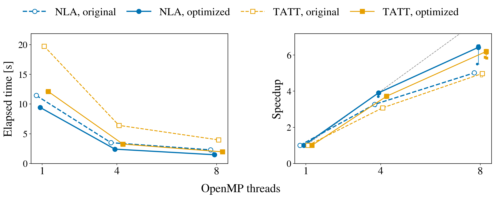
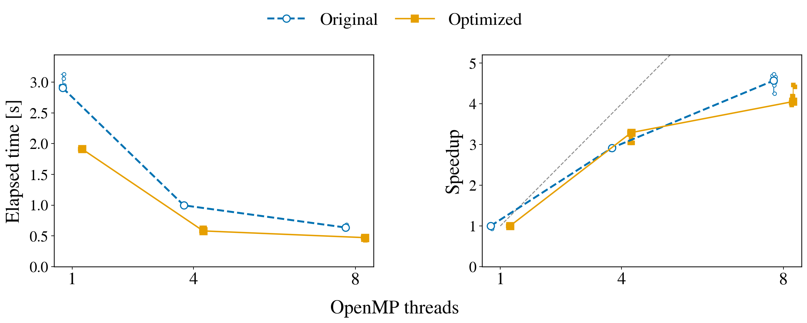

# Per-point rebuild versus prepared-geometry reuse

1. [Mean prediction](#mean)
2. [Covariance workload](#covariance)
3. [Numerical checks and saved inputs](#checks)

## Mean prediction <a name="mean"></a>

The table gives the median elapsed time for ten distinct parameter points
on the Apple M2 Pro. Each process first evaluates a separate warmup. CAMB
and fixed geometry preparation are excluded. Every changed point rebuilds
physical model values; repeated identical predictions do not enter these
measurements. BLAS uses one thread. The per-point-rebuild measurements are
those of [the 2026-11-17 record](../2026-11-17/README.md); the
prepared-geometry implementation is core commit `517eb15` on
`lowrank_fftlog`. The saved [data file](data.json) labels the two
implementations `original` and `optimized` in that order.

| Model | Implementation | Median seconds, one worker | Median seconds, four workers | Median seconds, eight workers |
|---|---|---:|---:|---:|
| NLA | Per-point rebuild | 11.453 | 3.502 | 2.285 |
| NLA | Prepared-geometry reuse | 9.424 | 2.411 | 1.467 |
| TATT | Per-point rebuild | 19.741 | 6.415 | 3.966 |
| TATT | Prepared-geometry reuse | 12.123 | 3.259 | 1.956 |



The prepared-geometry implementation prepares fixed interpolation
coordinates once, shares triangle and intrinsic-alignment geometry, and
refills cosmology- and IA-dependent values at each changed point. Signed
angular modes are assigned to workers according to their transform work.
The explicit triplet batch is twenty in the prepared-geometry experiment,
compared with four in the per-point rebuild; that shares physical
contractions across all source triplets and increases peak memory. The
general example default remains four.

These are finite-triangle aperture predictions with eighty entries,
FFT size 576, angular truncations L=M=20, and 65 line-of-sight nodes. They
are not an accuracy determination for the published DES analysis. In
particular, a 1.956-second median does not include CAMB or a complete joint
likelihood evaluation.

Direct projected-bispectrum checks found large high-multipole errors in
the coarse TATT interpolation used by this record
([the interpolation study](../../studies/interpolation_validation.md)).
Bitwise agreement establishes that the work-sharing changes preserved that
calculation, not that the interpolation is accurate, so these timings
cannot be quoted as the cost of a converged TATT forecast.

## Covariance workload <a name="covariance"></a>

| Implementation | Median seconds, one worker | Median seconds, four workers | Median seconds, eight workers |
|---|---:|---:|---:|
| Per-point rebuild | 2.907 | 0.997 | 0.636 |
| Prepared-geometry reuse | 1.913 | 0.581 | 0.472 |



This separate calculation uses eighty full-aperture entries, gravity-only
physics, and the large-area limit for short modes. Its illustrative area is
0.2 steradians and its diagonal shape-noise power $`2\times10^{-9}`$. The
counts are 64 ell, 32 azimuth, 256 radius, 32 mass, 512 halo-wavenumber,
64 window, and 33 line-of-sight nodes. These coarse settings have not
established covariance convergence, and they do not describe a
finite-triangle TATT covariance matched to the mean in the first table.

The reduction comes from distributing unequal halo rows across workers,
reusing the power–trispectrum contractions shared by observable pairs, and
evaluating only bispectrum field pairs required by the requested aperture
rows. All six saved covariance families keep their original values. The
power–bispectrum cross family is zero for this pure cubic vector; it is a
nonzero family in a joint quadratic/cubic calculation.

## Numerical checks and saved inputs <a name="checks"></a>

All sixty measured prepared-geometry mean vectors and six warmups agree
bitwise with the per-point rebuild. All covariance means and six term
arrays agree bitwise with the per-point rebuild and across worker counts.
The timing summaries and manifests record the corresponding frozen binary
and inputs.

[data.json](data.json) contains every elapsed time used in the figures.
Each dot is a different physical point. Ranges show the observed minimum
and maximum, including parameter dependence and machine variation; they
are not uncertainty estimates from repeated measurements of one model.

We assume Cocoa is active and the current directory is this benchmark
folder. The plotting operation uses only the saved numbers.

**Step :one:**: regenerate the separate mean and covariance PNG/PDF figures.

```bash
python plot_optimization.py
```

The plotting script needs NumPy and Matplotlib only. The data file explains
the measurement scope and specifies the two output names. It does not run
a physical calculation or require a compiled CosmoLike extension.
